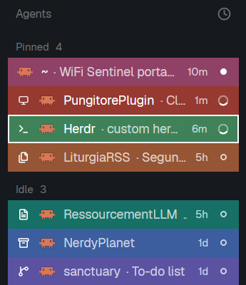

# Agents

The bottom half of the left sidebar: every agent Herdr knows about, one row each. A row is a solid block of the colour of the space the agent works in, deepened so the white lettering on it reads, with the agent's own program icon at the left and its state at the right — a spinner while it works, a square "Needs you" chip when it is stuck waiting for you, a ring when it is idle, a filled dot when it has finished. Rows come either in priority order (Needs you, Done, Working, Idle, each under a coloured header) or grouped under the space they belong to. A row reads "space · what it is doing", so you can tell two agents apart at a glance, and it carries how long the agent has been in this state. Sub-agents hang under their parent on a little tree of connector lines. Click a row and that agent's chat comes to the front; put the pointer on it and a pin appears that holds it to the top; the clock at the top right switches the whole list between the two orders.



**What you see:**

The block is the `agents` node of `layouts/herdr.json`: the lower of the two lists in the sidebar's `sidebar-lists` column — under `spaces`, above the 42px `dock` — with `weight: 1` and `min: 90`, so it takes half the space the two lists share inside the 268px `sidebar` column (the file's number; the person can drag the sidebar's outer edge wider or narrower, and the live width is whatever it has been dragged to). The mod paints its own background `theme().chrome` and puts a 1px `theme().border` hairline along its top edge. Body text is 13px.

Top to bottom:

- **Header bar, 41px** (14px of padding above, 5px below): "Agents" in 11.5px medium `theme().dim`, 16px from the left. At the right end a 14px glyph in `theme().dim` — `mods/workspace-chrome/clock.svg` in priority mode, `layers.svg` in grouped mode — turning `theme().foreground` under the pointer, with the tooltip "Sort agents: Priority" (or "…: Grouped by space").
- **The list.** 8px of padding left and right, scrollbar always shown (`overflow_y_scrollbar().mode("always")`).
- **An empty list.** 12px `theme().dim`, 12px of padding: "No agent status yet. Agents show up here when they report their status. Older versions and agents inside tmux may not."
- **A group header, 30px** with 8px of padding above it, 11px medium. In priority mode the header is the section: "Needs you" in `theme().blocked`, "Done" in `theme().done`, "Working" in `theme().working`, "Idle" in `theme().dim`; in grouped mode it is the space's name, in the space's own colour, with the space's icon (12px) before it. The count of members follows the name — always in priority mode, and only when the group is folded in grouped mode. Clicking the header folds or unfolds the group; folded, a priority group shows only the count and a chevron, a grouped one also shows the mark of its most urgent member — a "!", a spinner or a dot, but never the idle ring.
- **An agent row, 30px**, square corners, 8px of padding, filled with the space's colour deepened 34%, with a 1.5px border in that same colour — white instead, when the agent is the one in front. Left to right:
  - **The space's icon**, 12px in white, in a 14px slot, when the space has one.
  - **The program's icon**, 16px: the picture from `programs.json` when the program has no tint, otherwise the SVG tinted white.
  - **The name**, 13px, white (`#ffffff`), or `#ffffffb8` when the agent is idle and is not the one in front. Truncated at 200px, or at 120px when a detail follows.
  - **The detail**, after "· ", in `#ffffffb8`, truncated. In priority mode this is the tab name or the agent's own title; in grouped mode it is the row's name and the space's name is left out (it is in the header above).
  - **The machine**, 10px in `#ffffffb8`, for an agent running on another computer ("vps").
  - **The fold chevron**, 11px, when the agent has sub-agents: `chevron-down.svg` open, `chevron-right.svg` folded, with the number of sub-agents beside it when folded. Open, the glyph is white at 88% (`#ffffffe0`); folded, it takes the colour of the most urgent sub-agent.
  - **The pin**, 13px (`pin.svg`, or `pin-off.svg` on a pinned agent), white at 88%, in a slot with 2px of padding, on a white-at-20% (`#ffffff33`) square under the pointer, with the tooltip "Pin to the top" or "Unpin".
  - **The time in this state**, 11px in `#ffffffb8`, where the pin would be: "<1m", "7m", "3h", "2d".
  - **The status mark**, at the right-hand end.
- **The status marks.** Working: `mods/workspace-chrome/spinner.svg` at 12px, turning once every 900ms, white. Blocked: a square chip 18px high with 6px of padding, 10.5px semibold, reading "Needs you", white on black at 27% (`#00000045`) — where the section header already says "Needs you" (priority mode, an unpinned agent) a 14x14 square with a bold "!" takes its place. Idle: a 7px square with its corners rounded 4 and a 1.5px border — a ring — white at 72% (`#ffffffb8`). Done: the same 7px square filled solid, white.
- **A sub-agent row, 26px**, 39px of indent from the left and 8px from the right, corners rounded 8, on `theme().raised` when it is the agent in front. Left to right: the tree lines (a 9px column, each a 1.5px `theme().input` rule, with an elbow on "├" and "└"), the program's icon at 14px, the name in 12.5px (`theme().foreground` for the one in front, `theme().muted` otherwise), and the status mark.
- **The narrow rail**, when the sidebar is dragged under 160px wide. There is no header and no group header: each agent is a 26px row with its number (1, 2, 3 …) right-aligned in `theme().muted` and its status mark in a 14px slot, in `theme().working` / `theme().blocked` / `theme().idle` / `theme().done`. Below the list, a 28px centred row holds a "»" in 13px `theme().dim`, which puts the sidebar back to the width it had.

The six space colours are the ones the spaces list uses: `ansi6` `#22a99a`, `ansi3` `#e3814f`, `ansi4` `#5b8def`, `ansi5` `#8b7cf6`, `ansi2` `#3fae6a`, `ansi1` `#d9649a`; a space may also hold a colour of its own (`#rrggbb`). The row's ground is that colour darkened by 34%; the agent in front is that shade lightened 10% toward white; the row under the pointer, 20% toward white. In full, `ansi6`: row `#167066`, in front `#2d7e75`, under the pointer `#458d85`.

**How it behaves:**

- **What an agent is.** A terminal whose program reports a status (OSC 7501): `working`, `blocked`, `idle`, or `done` — "done" meaning it finished while the person was not looking, and becoming `idle` the moment they look at it, on any Herdr client.
- **Working**: the spinner turns; the row's time keeps counting up.
- **Blocked**: the agent wants the person. In priority mode it sits in the "Needs you" section and the row shows a bold "!" in a 14x14 black-at-27% square; in grouped mode the row shows the full "Needs you" chip; a pinned row always shows the full chip. The mark is the one place the row is not the space's colour.
- **Done**: a filled white dot; the row is filed in the "Done" section in priority mode.
- **Idle**: a white ring. The name is dimmed to `#ffffffb8` unless the agent is the one in front.
- **The time in this state** is the time since the agent last *changed* state, not since it started: it is stamped when the status changes, and looking at a finished agent does not reset it. A list seen for the first time stamps every agent at that moment, so everything reads "<1m" until something changes.
- **Click a row** and that agent's pane comes to the front (`pane.focus`). Click a sub-agent that has a pane and that pane comes to the front instead (`pane.focus {terminal}`); click a sub-agent without one and it is peeked over the tab (`terminal.peek`), which offers to keep it as a tab or close it.
- **Hover a row** and the pin appears in place of the time. Clicking it pins the agent (`terminal.pin`); the pinned agent moves to the top of the list under a "Pinned" header, and the pin on its row turns into `pin-off.svg` and reads "Unpin". The pin is a label on the terminal itself, so every Herdr client sees it, and it goes when the terminal ends.
- **Fold a group** by clicking its header, and unfold by clicking it again. Fold a single agent's sub-agents with the chevron at the end of its row — or by clicking the program's icon, which does the same thing.
- **The program icon folds, it does not focus.** Clicking it on a row that has sub-agents folds the tree and does not bring the pane forward; clicking it anywhere else brings the pane forward like the rest of the row.
- **Change the order** with the clock at the top right. A 200x140 popup opens with "Sort agents" over two rows, 31px tall: a 14px `clock.svg` (or `layers.svg`) in `theme().muted`, the name, and a `check.svg` beside the order in use. Choosing one writes `agents.sort` and closes the popup; the list re-sorts at once and the header glyph changes. The order is remembered between runs.
- **The list re-sorts by itself** as agents report. Priority order is blocked, then done, then working, then idle — a parent's place is taken by its most urgent sub-agent — and within one urgency, the agent that changed most recently comes first. Grouped order is the spaces in the order Herdr lists them, agents of one space next to each other.
- **Sub-agents** are terminals an agent started with `hc run`. They hang under their parent on connector lines, deepest first. One that has a pane of its own loses its row in the list (it is shown in the tree), unless it is pinned.
- **Navigation follows the list.** The mod hands Herdr the order of the rows it is showing, so `agent.next` and `agent.prev` walk the agents in the order on screen, and the agent in front is ringed in white.
- **The rail** (sidebar under 160px) lists the same agents as numbers with their status marks; clicking a number brings that pane forward, and the "»" at the bottom gives the sidebar its width back.

**Built from:**

- **The layout.** `layouts/herdr.json`, the user's own layout:

  ```
  root (row, background canvas, divider 1px border, titlebar none)
  ├── sidebar (column, 268px, min 44, max 480, background chrome, resizable false)
  │   ├── brand (block, mod workspace-chrome, 46px, window_drag)
  │   ├── sidebar-lists (column)
  │   │   ├── spaces (block, mod herdr-spaces, weight 1, min 90)
  │   │   └── agents (block, mod herdr-agents, weight 1, min 90)   ← this mod
  │   ├── dock (block, mod herdr-dock, 42px)
  │   └── sidebar-footer (block, mod workspace-chrome, props footer, 69px)
  ├── work (column, resizable false)
  │   ├── tabs (block, mod herdr-tabs, 42px, window_drag)
  │   ├── work-body (row, padding 8, gap 8)
  │   │   ├── main (block, tab active, pane header herdr-pane 30px top, focus #3fae6a)
  │   │   └── panel (column, 368px, min 280, max 900, hidden)
  │   └── status (block, mod workspace-status, 28px)
  ├── b037df0d3652bd6c4a10ae48774b1a586 (block, mod pungitore-panel, 320px)
  └── b9551b734870187e1a35348b0ac6321f0 (block, mod zz-dump, 200px)
  ```

  The mod's block carries no props: `{ "mod": "herdr-agents" }`. `mod.json` is `{ "place": "none", "title": "Agents", "cloned_from": { "name": "agents", "version": "0.1.16" } }` — `"place": "none"` means it appears only where a layout puts it.
- **The mod itself.** `mods/herdr-agents/main.js`, a clone of Herdr's shipped `agents` mod (version 0.1.16) with these changes:
  - The row is filled with the space's own colour deepened 34% instead of the theme's `selected` colour, and the agent in front is marked by a 1.5px white border rather than a background.
  - The space's icon is drawn on the row (12px, white) and on the group header in grouped mode (12px, in the space's colour).
  - The name, the detail, the machine and the time are white / white-at-72% instead of `theme().foreground` / `theme().muted` / `theme().dim`.
  - The status marks are drawn for a coloured ground: the spinner white, the "Needs you" chip black at 27% (`#00000045`) with white text (the shipped mod rounded it 5), the idle ring white at 72% (`#ffffffb8`), the done dot white.
  - The row's corners are square; the shipped mod rounded them 8, and rounded the compact "!" 4.
  - The pin button under the pointer is white at 20% (`#ffffff33`) with a white glyph, and the open fold chevron is white at 88% (`#ffffffe0`).
  - In grouped mode a group header wears the space's colour instead of `theme().dim`.
  - The sort popup opens `herdr-agents`; the shipped mod opens `agents`.
  Everything else — the sorting, the labels, the sub-agent tree, the durations, the pin, the timings — is the shipped mod's code, unchanged.
- **`herdr` functions it calls.** `agents()`, `terminals()`, `panes()`, `focused()`, `spaces()`, `theme()`, `layout()`, `window()`, `shared(key)`, `setShared(key, value)`, `props()`, `run(name, args)`, `setAgentOrder(addresses)`, `openOverlay(spec)`, `closeOverlay(id)`.
- **Commands it runs.** `pane.focus {pane}` (a row), `pane.focus {terminal}` (a sub-agent with a pane), `terminal.peek {terminal}` (a sub-agent without one), `terminal.pin {terminal, pinned}` (the pin, and the migration of old pins), `layout.resize {id: "sidebar", px}` (the rail toggle).
- **Overlays it opens.** `herdr-agents` as a popup 200x140 with `props {sortMenu: true}` — a second copy of the mod, which sees the props and draws the sort menu instead of the list.
- **Shared state.** It reads `space.colors` (space id → colour name or `#rrggbb`) and `herdr.spaceIcons` (space id → an emoji or `svg:<name>`) — the same keys `herdr-spaces`, `herdr-look`, `herdr-pane` and `herdr-tabs` read, so every one of them agrees on a space's colour and icon — and `agents.sort` (`"priority"` or `"grouped"`). It writes `agents.sort` and, for the rail, `sidebar.width` and `sidebar.collapsed`.
- **Its own storage.** `localStorage["changed"]` (each agent's last status and when it changed) and `localStorage["pins"]` (addresses to re-pin), both per copy of the mod.
- **Its art.** `mods/workspace-chrome/`: `spinner.svg`, `chevron-down.svg`, `chevron-right.svg`, `pin.svg`, `pin-off.svg`, `check.svg`, `clock.svg`, `layers.svg`, and the space icons (`file-text.svg`, `monitor.svg`, `terminal.svg`, `git-branch.svg`, `archive.svg`, `files.svg`, …). A program's own icon comes from `programs.json` (`icons/claude.svg`, …) and is drawn as a picture when the program has no tint.
- **A timer.** `cx.timer.every(30000)` — one redraw of the whole window every 30 seconds, so the minutes in a row move on.

**Watch out:**

- **A bug: the folded group header ignores sub-agents.** The "most urgent" mark on a folded group header is taken from the members' *own* statuses (`a.status`), while the section a row is filed under in priority mode is taken from the agent *and* its sub-agents (`urgency`). So an agent that is "working" but has a blocked sub-agent is filed under "Needs you", yet a folded grouped space header for it shows no "!", and a folded priority section shows only a count. Fix it by using the same rank for both.
- **The rail is reachable in this layout, and the sibling recipe says otherwise.** The sidebar column has `"resizable": false`, but that governs the splits *inside* the sidebar; the sidebar's outer edge belongs to the root row, which is resizable, so the person can drag the sidebar narrow and the rail appears. (The live sidebar in this setup is already wider than the file's 268px.) The rail lists only agents that have a pane, and its numbers are positions in the list, not identities — they move when the list is re-sorted.
- **The mod never calls `agent.focus`.** It focuses panes instead, so the command that focuses an agent by address is unused here.
- **The pin is a core label, not this mod's own state.** `terminal.pin` writes `herdr.pinned` on the terminal, so every Herdr client sees the same pinned agents, and the pin goes when the terminal ends.
- **The pins migration is inert on a fresh install.** `localStorage["pins"]` only exists if an older build wrote it; when it does, the mod re-pins those terminals once, and drops the entry only after the core has echoed the label back.
- **The status is only as good as the program.** An agent that never sends OSC 7501 never appears, and neither does a sub-agent without a pane except inside its parent's tree. The empty-state text says as much.
- **A row's name is guessed.** The agent's own title is cleaned of a leading status glyph or spinner and the separator after it ("✦  Working", "⠋ - Thinking"), but a title that starts with a bracket or a quote keeps it ("[web] login"), and a title that looks like a path (`~`, `/`, `C:\`) is never used as a name. A title that is only digits (an automatic tab number) is replaced by the program name, unless two rows in the same space would then read the same, in which case the number is kept after a "· ". Otherwise the tab's name is used.
- **The name is truncated at 200px** (120px when a detail follows it), so a long space or tab name is cut.
- **Every redraw of this mod redraws the whole window**, and the mod redraws on every pointer enter and leave (the hover state), every 30 seconds (the timer), and on every live-data change Herdr pushes at it.
- **The mod writes while it renders.** `setAgentOrder` is called on every render, and `migratePins` can call `terminal.pin` from inside a render.
- **The mod assumes other mods are installed**: `herdr-look` (which writes `space.colors` and `herdr.spaceIcons`) and the `workspace-chrome` SVGs. With no colours set, every space falls back to `ansi6` (`#22a99a`) and every row looks the same; with no icons set, no space icon is drawn.
- **Sizes that matter.** The block's `min: 90`; a row is 30px, a sub-agent row 26px, a group header 30px, the header bar 41px. The list scrolls, so nothing is cut off, but only a handful of agents are visible at once in a 268px sidebar.
- **The layout has one broken block next door.** `herdr-app status` reports `mod zz-dump: ... does not exist` — the last 200px block of `layouts/herdr.json` points at a mod that is not there. It is not this mod's doing, but it shows up in every check of the window.
- **`herdr-app check` passes** with no warnings: the mod runs no programs, calls `hc` not at all, and calls `terminal.pin` only when there are old pins to migrate.

**Done when:**

- `herdr-app check ~/.config/herdr-app/mods/herdr-agents` exits 0.
- With two agents running in two different spaces, the sidebar shows two 30px rows, each filled with its space's colour deepened 34% (`#167066` for `ansi6`, `#2a7346` for `ansi2`), the program icon at the left in white, the name in white, and the space's icon before it when the space has one.
- An agent that is working shows a 12px spinner turning; one that is blocked shows the "Needs you" chip; one that is idle shows a white ring; one that has finished shows a filled white dot.
- The agent whose chat is in front carries a 1.5px white border; every other row's border is its own ground colour, so no border shows.
- The row's time counts up and reads "<1m", then "1m", then "1h", then "1d"; it restarts when the agent's status changes.
- Clicking a row brings that agent's pane to the front, and the row gains the white border.
- Putting the pointer on a row swaps the time for a pin; clicking the pin moves the agent under a "Pinned" header at the top of the list, and the pin on its row becomes `pin-off.svg`.
- Clicking a section header folds its rows away and leaves the header with its count and a right-pointing chevron; clicking it again brings them back.
- With an agent that has sub-agents, the tree lines and the sub-agent rows appear under it, each with its own status mark, and the chevron at the end of the row folds them.
- Clicking the 14px glyph at the top right opens a 200x140 popup with "Sort agents", "Priority" and "Grouped by space", and a check beside the order in use; choosing "Grouped by space" re-groups the list under space headers in the spaces' colours, and the header glyph becomes `layers.svg`. The choice survives a restart.
- `agent.next` and `agent.prev` move through the agents in the order the list shows them.
- Dragging the sidebar under 160px replaces the list with the rail: numbers and status marks only, and the "»" at the bottom gives the sidebar its width back.
