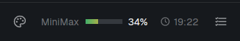

# Dock

A 70-pixel strip at the foot of the Herdr sidebar, between the spaces list and the Settings footer. It holds two rows. The upper row appears only when the Learning Loop has candidate lessons waiting for a decision, and reads "7 lessons to review". The lower row always holds a small round glyph that opens the theme list and a live read-out of how much of the MiniMax plan the current five-hour window has used. The read-out is the only part that is alive — it names the plan, draws a thin bar that fills as the plan is spent and slides from green through amber to red, prints the percentage, and says when the window closes. The other two are doorways: each opens its own panel beside the bar.

**What you see:**

Two rows, 70px tall in all, the full width of the sidebar column (268px in `layouts/herdr.json`, node `sidebar`, `size: {px: 268}`) on the sidebar's `chrome` background (#16191d in the theme in use). A 1px hairline in the theme's `border` colour runs along the top edge. The rows are `px(8)`, `gap(4)`, everything centred vertically.

*The upper row* — only when there is something to review:

- A row 24px tall, `px(6)`, `gap(6)`, rounded 6, filling the width, `t.hover` under the pointer.
- At the left a 13px layers glyph (`mods/workspace-chrome/layers.svg`) in `t.muted`.
- Then the words **"7 lessons to review"** — the number in 10.5px `t.muted`, cut off with an ellipsis when the sidebar is narrow. One lesson reads **"1 lesson to review"**.

*The lower row* — always there:

1. **Themes glyph** — a 26x26 square with 6px rounded corners and no fill until the pointer is on it (then `t.hover`), holding a 14px glyph in `t.muted`. Its tooltip reads "Themes".
2. **Plan strip** — the flexible middle, 188px of the row's 252px of content, 26px tall, `px(4)`, `gap(6)`, 6px rounded corners, `t.hover` under the pointer; the whole strip is one click target and one tooltip. Inside, left to right:
   - the word **MiniMax**, 10.5px, `t.dim`;
   - the **bar**: 5px tall, 3px rounded ends, the unused part in `t.raised` (#35393e as it reads now), built from 36 separate segments;
   - the **percentage**, in a 28px slot, 10.5px, `t.foreground` — "22%", "—", or "full";
   - the **reset time**: an 11px clock glyph in `t.dim`, then the time in 10.5px `t.dim` — "19:22" today, "Tue 00:12" when it falls tomorrow, "Wed 17 19:22" further out.
   - The word "MiniMax" and the reset time disappear when the sidebar is narrower than 160px; the bar and the percentage stay.

**How it behaves:**

- **Hover** paints `t.hover` behind whichever target the pointer is on. The strip's tooltip is the plan in one line: `MiniMax M: 22% of the 5-hour window used · credits back 14:20 · resets 19:22`. The Themes glyph only says "Themes"; the lessons row says "Candidate lessons waiting to be promoted into your rules".
- **Click the Themes glyph** and a 250x170 popup opens beside the bar with the three themes: Default (dot `#61afef`), Tron blue (`#4dd2ff`), Tron orange (`#ff9f1c`). The one in use is highlighted and carries a check; picking a row switches the app's theme and closes the popup.
- **Click the plan strip** and a 320x220 popup opens with the plan in full: the model name, a "5h window" meter, a "this week" meter when the plan has one, and up to four past "credits back" times.
- **Click the lessons row** and a 420x460 popup opens with the candidate lessons waiting for a decision: one card per candidate with its id, the folder it came from, the day it was staged and the lesson itself; below them a **"Run the command"** button that runs the Learning Loop's own `staging.js list` and shows what it prints.
- **Keys** reach the mod by its name: `ctrl-shift-g` = `herdr-dock.theme`, `ctrl-shift-i` = `herdr-dock.pin`.
  - `ctrl-shift-g` does **not** open the theme panel — it steps the theme through Default → Tron blue → Tron orange → Default, with no popup.
  - `ctrl-shift-i` pins or unpins the space in front and says so in a toast: "Pinned" with the space's name, or "Unpinned". A pinned space grows an 8px white pin glyph at the right of its row in the Spaces list, and its menu offers "Unpin space" instead of "Close" (it reads "Close (pinned — unpin first)" and refuses with a warning).
- **The three states of the plan strip.** Before the first read it says "Reading the plan…" in `t.dim`. If the plan cannot be read it says "No plan" in `t.dim` and the tooltip carries the error. Otherwise it shows the bar, the percentage and the time.
- **When the five-hour window has closed**, the plan gives the whole quota back: the bar empties, the percentage reads "full" (not "0%"), and the tooltip says `MiniMax M: the 5-hour quota is whole — it came back at 19:22`.
- **The lessons row is a fact, not a to-do.** The count comes from the Learning Loop's own marker (`<!-- pungitore-learning: pending N -->`), which is published for exactly this purpose (ADR-0013). The dock reads the marker; the *list* behind the number is read by `herdr-panel`, which opens the popup. A machine without the Learning Loop installed reads zero and shows no row at all.
- **What moves:** the bar and the percentage change when the plan is read — at start, then once a minute — and the bar's colour changes as the plan is spent. The clock text changes shape when the reset falls on another day. Nothing animates: there is no spinner and no per-frame redraw.
- **No agent status appears here.** The dock never asks for `agents()`; the Agents list above it owns working, blocked, done and idle.

**Built from:**

- **The layout.** `layouts/herdr.json` puts the mod in the `sidebar` column (a column of four children, `size: {px: 268}`, `min: 44`, `max: 480`, `background: "chrome"`, `resizable: false`):
  - `brand` — block, `workspace-chrome`, 46px;
  - `sidebar-lists` — column, no size of its own, holding `spaces` (block, `herdr-spaces`, `size: {weight: 1}`, `min: 90`);
  - `dock` — block, `content: { "mod": "herdr-dock" }`, `size: {px: 70}`, **no props**;
  - `sidebar-footer` — block, `workspace-chrome` with `props: { "footer": true }`, 69px (Settings, Add machine).
  The dock's own root is `v_flex().id("herdr-dock").size_full().px(8).gap(4).items_center().border_t(1).border_color(t.border)`, so the hairline is the mod's, drawn inside its 70px block. The block is 70px so the second row has room to appear; with nothing to review the upper row is absent and the lower row sits centred in the block.
- **`mod.json`** is `{ "place": "none", "title": "Dock" }` — the mod never docks itself; only the layout places it, and it is not `focusable`, so it never takes the keyboard.
- **The mod.** `main.js` default-exports `class Dock extends View` (from `gpui-kit`), using `v_flex` and `h_flex` from `gpui-base`. `init` reads the shared usage, returns early when `checking()` is true, spawns the first read, starts `cx.timer.every(60000, …)`, and runs a `nextCommand()` loop for its own key commands. `render` draws the two rows.
- **The other mods it opens**, each with the props that decide what it shows:
  - `herdr-panel`, `kind: "popup"`, 250x170, `props: { panel: "theme" }` — the theme list;
  - `herdr-panel`, `kind: "popup"`, 320x220, `props: { panel: "usage" }` — the plan in full;
  - `herdr-panel`, `kind: "popup"`, 420x460, `props: { panel: "lessons" }` — the lessons waiting for a decision.
- **The `herdr` functions it calls:** `theme()`, `themes()`, `run()`, `shared()`, `setShared()`, `spaces()`, `exec()`, `openOverlay()`, `checking()`, `nextCommand()`, `notify()`, `layout()`, `home()`.
- **The app command it runs:** `app.theme { name }` — the only one, from the theme cycle.
- **The programs it runs:**
  - `mmx quota show --output json` through `exec`, locally, with a 20,000ms timeout. It reads `model_remains` and takes the first entry whose `model_name` matches `/m3|flash|general/i`, or the first entry. From it the dock keeps `current_interval_remaining_percent`, `start_time`, `end_time`, `current_weekly_status`, `current_weekly_remaining_percent`, `weekly_start_time` and `weekly_end_time`. The MiniMax key stays in `~/.mmx/config.json`; the mod never touches it.
  - `grep -rhoE --include=*.md "<!-- pungitore-learning: pending [0-9]+ -->" ~/.claude/plugins/data`, with a 5,000ms timeout, to count the candidates waiting. The counts are summed, because more than one plugin may publish them.
- **The shared keys it reads and writes** (every mod sees these, and writing re-renders every mod):
  - `herdr.usage` — read at init and on render, written on every read: `{ at, ok: true, model, interval: { pct, start, end }, weekly: { pct, start, end } | null }`, or `{ at, ok: false, error }` when the plan could not be read. `pct` is the *remaining* percent.
  - `herdr.pinned` — the list of space ids that must not be closed by accident; also read by `herdr-spaces` and `herdr-menu`.
  - `herdr.pinNew` — true while every space is pinned, so spaces made later are pinned too (`herdr-spaces` reads it).
  - `herdr.theme` — the last theme name chosen by the dock or the panel.
  - `herdr.usageResets` — the windows seen, newest first, each `{ start, end, at }`, at most 24. The dock only writes it; `herdr-panel` reads it.
- **Its own commands**, delivered through `nextCommand()` as the part after the dot: `herdr-dock.theme`, `herdr-dock.lessons`, `herdr-dock.pin`, `herdr-dock.pinall`, `herdr-dock.unpinall`. `keys.json` binds `theme` (`ctrl-shift-g`) and `pin` (`ctrl-shift-i`).
- **Its art** (SVG, tinted with the text colour, resolved from `~/.config/herdr-app`):
  - `palette.svg` — the Themes glyph, 14px, `t.muted`;
  - `clock.svg` — the glyph beside the reset time, 11px, `t.dim`;
  - `gauge.svg` — not referenced by any code in this mod.
  The lessons row uses the shipped `mods/workspace-chrome/layers.svg`.

**Watch out:**

- **`gauge.svg` (the speedometer) is dead art.** Nothing references it.
- **The button and the key do different things.** The Themes glyph opens the panel; `ctrl-shift-g` cycles the three picks with no panel at all.
- **The cycle has to guess which theme is in use.** It compares ten colour keys (`background`, `foreground`, `muted`, `accent`, `selection`, `border`, `canvas`, `surface`, `raised`, `input`) against every installed theme and accepts a match only at 95% or better; a colour override in `settings.json` breaks the match, and the mod then falls back to the shared `herdr.theme` key. If neither works, the first press lands on `atom-one-dark`.
- **`mmx` must be on `PATH` and must answer with `model_remains`.** Without it the strip reads "No plan" and the tooltip carries the error; the check for it is `mmx quota show --output json` exiting 0 within 20s.
- **`current_weekly_status === 3` means "no weekly limit"**, and the dock then stores `weekly: null`. The dock never shows the weekly figure at all — only `herdr-panel` does.
- **The bar is not a gradient.** Boxes take no gradient, so the bar is 36 flat segments, and each segment is coloured by *its own* position on the ramp, not by how much is used: the first segment is near `#3fae6a`, the last near `#e2564a`. Only the segments whose position falls within the used percentage are filled — at 22% that is 8 of 36, running `#3fae6a` to about `#7eb056`; the rest stays `t.raised`. The three ramp colours are the mod's own, not the theme's: green `#3fae6a`, amber `#d7b23a`, red `#e2564a`.
- **The percentage is `100 − remaining`, clamped to 0..100**, and the label means different things in different states: "22%" while the window is running, "—" when the plan gives no percentage, "full" once the window has ended (the bar is then empty, because the quota is whole again — "full" means the quota is full, not that the bar is).
- **The narrow branch needs a sidebar under 160px.** `narrow()` reads the *live* layout tree's sidebar `size.px` and needs it under 160; this layout declares 268px. The sidebar column's own `"resizable": false` only stops resizing *within* it — the boundary that sizes it belongs to the root row, which is resizable, so dragging that edge (or `layout.resize {id: "sidebar", px: 240}`) narrows it and the "MiniMax" word and the reset time disappear.
- **The poll runs for the life of the window.** `cx.timer.every(60000)` starts a `mmx` process every minute and is never stopped, even when the sidebar is hidden. Every poll whose end time differs writes another entry to `herdr.usageResets` (at most 24 kept), which the dock never reads back — `herdr-panel` does. The same poll counts the lessons, so the number is at most a minute old.
- **`init` returns early when `checking()` is true**, so `herdr-app check` loads and renders the mod without polling `mmx`, without counting the lessons and without starting the command loop. But `init` runs for real during a check, so anything added above that guard still runs.
- **`herdr-dock.pinall` and `herdr-dock.unpinall` work but nothing binds them.** `keys.json` binds only `theme` and `pin`; the same thing is in the global context menu as "Pin every space" and "Unpin every space". Both commands also flip `herdr.pinNew`, so spaces made later are pinned too.
- **Pinning is a soft guard held by the mods, not by Herdr.** `herdr-menu` replaces "Close" with "Close (pinned — unpin first)" and warns instead of closing; `herdr-spaces` draws the pin glyph. A `space.close` run from the command palette still closes a pinned space.
- **The mod never takes the keyboard** — no `"focusable": true`, no focus handle — and it takes no props of its own; the layout gives it none and the overlays pass their own.
- **A fresh build should not trust the file names.** `clock()` in the code means the *time* ("14:20" today, "Tue 00:12" tomorrow, "Wed 17 14:20" later), and `gauge.svg` is not the gauge in the bar.

**Done when:**

- `herdr-app check ~/.config/herdr-app/mods/herdr-dock` exits 0, and `herdr-app status` reports no error for the mod.
- In the `herdr` layout the sidebar's last block above Settings is a 70px strip with a hairline above it; its lower row holds (left to right) a round glyph, the word "MiniMax", a 5px bar, a percentage and a clock time.
- With the Learning Loop installed and candidates waiting, the strip shows a row above that one reading "7 lessons to review"; with nothing waiting, that row is not there and the lower row sits centred in the block.
- Clicking the lessons row opens a popup listing the candidates and a "Run the command" button, and the button prints the Learning Loop's own list.
- With `mmx` working, the strip shows a number equal to `100 − current_interval_remaining_percent`, and the bar's filled part is the leading `round(36 × used/100)` segments, green at the left.
- With `mmx` off the `PATH`, the strip reads "No plan" and hovering it shows the error.
- Clicking the left glyph opens a popup with the three rows Default, Tron blue and Tron orange, each with its coloured dot; clicking Tron blue changes the app's theme and closes the popup.
- Clicking the plan strip opens the usage popup showing "MiniMax M", the model name and the "5h window" meter.
- `ctrl-shift-g` steps the app's theme through the three picks without opening a popup.
- `ctrl-shift-i` on a space shows a toast reading "Pinned" with that space's name and puts a white pin glyph at the right of its row in the Spaces list; pressing it again shows "Unpinned" and takes the glyph away.
- Resizing the sidebar to under 160px in the layout (its edge cannot be dragged: the sidebar is `"resizable": false`) leaves the bar and the percentage and drops the "MiniMax" word and the reset time.
