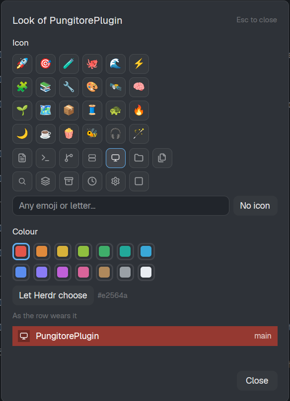

# Space look

Right-click a space in the sidebar and choose "Icon and colour…" — a 430×600 dialog opens, named for that space, and it is the one place a space gets a face. Pick one of twenty-four emoji, one of thirteen of Herdr's own glyphs, or one of fourteen colours, and the space's row in the sidebar, the active tab's colour in the tab bar, the pane header and every agent row in that space change with it: the icon sits on a dark square chip in front of the name, the name in white on a deepened version of the colour, and the same row is previewed at the bottom of the dialog exactly as the sidebar draws it.

**What you see:**

The dialog is 430×600 (`mod.json`: `overlay: { width: 430, height: 600 }`), rounded 8, padded 16 all round, filled with `theme().popover`, base type 13. Three bands, top to bottom:

- **Header** (row, gap 8): the title "Look of *{space name}*" at 15px semibold in `theme().foreground` on the left, a flexible gap, then "Esc to close" at 11px in `theme().dim` on the right. If the space is gone by the time it renders, the title is the bare word "Look".
- **Body** — the only part that scrolls (`flex_1`, `min_h(0)`, `overflow_y_scrollbar`), 14px between its two sections:
  - **Icon** (label row: "Icon", 12.5px semibold, `theme().foreground`):
    - 24 emoji in a grid of 6 across and 4 down, cells 30×30, `rounded(7)`, a 1px border (`theme().border`, or `theme().accent` when that emoji is the space's), background `theme().raised` (`theme().selected` when chosen), on hover the background becomes `theme().hover`. The emoji itself is 15px. The grid is 🚀 🎯 🧪 🐙 🌊 ⚡ / 🧩 📚 🔧 🎨 🛰️ 🧠 / 🌱 🗺️ 📦 🧵 🐢 🔥 / 🌙 ☕ 🍿 🐝 🎧 🪄.
    - 13 Herdr glyphs in a grid of 7 across and 2 down (the second row holds 6), the same 30×30 cells and the same hover and selected rules, but the glyph is a 14px SVG in `theme().muted` (`theme().foreground` when chosen): `file-text`, `terminal`, `git-branch`, `server`, `monitor`, `folder`, `files`, `search`, `layers`, `archive`, `clock`, `settings`, `square`.
    - A last row: a text field (`flex_1`, 30 tall, `px(9)`, `rounded(8)`, 1px border in `theme().input`, background `theme().background`, placeholder "Any emoji or letter…") and beside it a "No icon" button (30 tall, `px(10)`, `rounded(8)`, background `theme().raised`, or `theme().selected` when the space has no icon at all, text in `theme().foreground`).
  - **Colour** (label row: "Colour", 12.5px semibold, `theme().foreground`):
    - 14 swatches in a grid of 7 across and 2 down, cells 26×26, `rounded(7)`, a 2px border (`theme().accent` when that colour is the space's, else `theme().border`), on hover the whole cell drops to 85% opacity. Inside each cell a 16×16 `rounded(4)` chip in the colour itself. In order: `#e2564a` `#e08a3c` `#d7b23a` `#8fbf3f` `#3fae6a` `#22a99a` `#3aa8d8` `#5b8def` `#8b7cf6` `#c060d8` `#d9649a` `#b0895c` `#9aa0a6` `#e9edf2`.
    - A row under it: a "Let Herdr choose" button (30 tall, `px(10)`, `rounded(8)`, background `theme().raised`, or `theme().selected` when the space has no colour of its own) and, to its right, an 11px `theme().dim` readout — either the stored value or the words "no colour of its own".
    - A caption "As the row wears it" (11px, `theme().dim`).
    - **The preview row**: 30 tall, `px(8)`, gap 9, square corners, filled with the space's colour deepened by 34%. At its left an 18×18 square chip — the chosen icon in white on `#00000045` (an SVG glyph at 13px, an emoji at 13px) or, with no icon, the space's first letter in 10.5px bold white on `#ffffff30`. Then the space's name in white, truncated, and hard against the right edge the fixed word "main" at 11.5px in `#ffffffb8`.
- **Footer**: a right-aligned "Close" button (30 tall, `px(13)`, `rounded(8)`, background `theme().raised`, text in `theme().foreground`, on hover 90% opacity).

The colours the row wears, once deepened by the 34% the sidebar and the agents list use, and by the 40% the tab bar and the pane header use:

| picked | sidebar row, agents row (×0.66) | tab bar, pane header (×0.6) |
|---|---|---|
| `#e2564a` | `#953931` | `#88342c` |
| `#e08a3c` | `#945b28` | `#865324` |
| `#d7b23a` | `#8e7526` | `#816b23` |
| `#8fbf3f` | `#5e7e2a` | `#567326` |
| `#3fae6a` | `#2a7346` | `#266840` |
| `#22a99a` | `#167066` | `#14655c` |
| `#3aa8d8` | `#266f8f` | `#236582` |
| `#5b8def` | `#3c5d9e` | `#37558f` |
| `#8b7cf6` | `#5c52a2` | `#534a94` |
| `#c060d8` | `#7f3f8f` | `#733a82` |
| `#d9649a` | `#8f4266` | `#823c5c` |
| `#b0895c` | `#745a3d` | `#6a5237` |
| `#9aa0a6` | `#666a6e` | `#5c6064` |
| `#e9edf2` | `#9a9ca0` | `#8c8e91` |

**How it behaves:**

- **Opening.** The space's context menu item "Icon and colour…" closes the menu and opens this mod as a dialog with `props { space: <space id> }`. The same dialog opens from the sidebar: hovering a space row shows three small buttons, the middle one a palette, and its tooltip is "Its icon and colour". Opened with no props at all (`herdr-app do mod.open --name herdr-look`), the mod falls back to the space that is active.
- **Choosing an icon.** Clicking an emoji or a glyph writes it to that space immediately. The space's row in the sidebar changes at once — the icon on its dark chip in front of the name — and so do the agent rows of that space, which show the same icon. Clicking the chosen icon again leaves it chosen: nothing here is a toggle, and "No icon" is the only way to clear one.
- **Choosing a colour.** Clicking a swatch writes that hex to the space. The sidebar row, the agents rows of that space, the active tab in the tab bar and the pane header all repaint at once, behind the dialog. The chosen swatch is the only one with an accent border.
- **Letting Herdr choose.** The button removes the space's colour, and the sidebar hands it one of its own six from the palette (`ansi6`, `ansi3`, `ansi4`, `ansi5`, `ansi2`, `ansi1`), picking the one least used. A space named "~" is the one exception: it is never given a palette colour and keeps the default teal.
- **Typing an icon.** The field takes one character: the first character of what you typed, trimmed. Enter applies it and clears the field. Typing "a" gives the letter a; typing "abc" gives "a".
- **Keys.** Escape closes the dialog — the mod handles it on its own root and stops the key there; Herdr's own "Escape closes the top dialog" would close it regardless. There are no other keys: no arrows, no tab-to-next, no Enter-anywhere-but-the-field.
- **Hover.** Emoji and glyph buttons change to `theme().hover`; swatches dim to 85% opacity; "No icon", "Let Herdr choose" and "Close" change background or opacity. Nothing in the dialog moves or animates.
- **Agent statuses.** This mod draws no agent statuses of its own — it has no agents list. What it changes is the ground they sit on, in the Agents list: **working** is a ring that turns once every 900ms (`spinner.svg`, 12px) drawn white on the space's colour; **blocked** is a "Needs you" pill (18 tall, 10.5px semibold) in white on `#00000045`, or a bold "!" in a 14px square in the compact sidebar; **done** is a 7px filled white dot; **idle** is a 7px ring with a 1.5px `#ffffffb8` border. In the Spaces sidebar the space's own row shows "●" for blocked or done and "·" otherwise, in the theme's status colour.
- **The space's own row** (for reference, drawn by `herdr-spaces`, not here): the colour deepened by 34%, the name in white, the icon on an 18px `#00000045` chip or the first letter on an 18px `#ffffff30` chip, and a status mark on the right. The active row is that colour lightened by 10%; an inactive row under the pointer is it lightened by 20%.

**Built from:**

- **Not in the layout.** `mod.json` is `{ "place": "none", "title": "Space look", "overlay": { "width": 430, "height": 600 } }` — `"none"` means the mod never docks into a block; it exists only as an overlay. The tree it customises is `layouts/herdr.json`: `root` (row) → `sidebar` (column, 268px) → `brand` (`workspace-chrome`, 46px), `sidebar-lists` (column) → `spaces` (`herdr-spaces`, weight 1, min 90) and `agents` (`herdr-agents`, weight 1, min 90), `dock` (`herdr-dock`, 42px), `sidebar-footer` (`workspace-chrome` with props `{ footer: true }`, 69px); `work` (column) → `tabs` (`herdr-tabs`, 42px), `work-body` (row) → `main` (the active tab's pane, header `herdr-pane`, 30px) and `panel` (368px, hidden) → `panel-body` (stack of `files` and `changes`), `status` (`workspace-status`, 28px); then `pungitore-panel` (320px) and `zz-dump` (200px). The blocks that read what this mod writes are `spaces` and `agents` in the sidebar, plus `tabs` and the `herdr-pane` header.
- **Props roles.** `props().space` — the id of the space being dressed; when absent, the active space. `props().overlay` — the overlay's id, used to close the dialog.
- **Who opens it.** `herdr-menu` handles the string `"herdr.look"` in the space menu specially: it closes the menu, then `openOverlay({ mod: "herdr-look", kind: "dialog", width: 430, height: 600, props: { space: args.id } })`. `herdr-spaces` opens the same overlay from the palette button on a hovered row. `herdr.look` is not an app command — `herdr-app do herdr.look` will not work.
- **Where it keeps what it decides.** Two shared keys, both keyed by space id: the icon in `herdr.spaceIcons`, the colour in `space.colors`. `space.colors` is the key the shipped `spaces` and `picker` mods also read, so a hex written here is one they understand; `herdr.spaceIcons` is a personal key read only by `herdr-spaces` and `herdr-agents`. Both survive a restart.
- **The `herdr` functions it calls:** `props()`, `theme()`, `spaces()`, `shared()`, `setShared()`, `closeOverlay()`. It imports `checking` but never uses it — it starts no helpers, so there is nothing to guard. It calls no commands (`run()` never appears) and runs no programs: no `exec`, no `hc`, no network, no files read or written. It only ever writes shared state.
- **Shipped mods it uses:** none by code. It borrows the shipped `workspace-chrome` mod's art — the thirteen glyph SVGs live at `mods/workspace-chrome/{file-text,terminal,git-branch,server,monitor,folder,files,search,layers,archive,clock,settings,square}.svg`, not in this mod's own folder, and are drawn in both the glyph grid and the preview. The menu's icon for this action is `mods/herdr-dock/palette.svg`, from the personal `herdr-dock` mod.
- **Its own art:** the 24 emoji and the 14 colour chips are in the source; it ships no images of its own.
- **The maths.** `deepen(colour, amount)` multiplies each channel by `1 − amount` and only understands `#rrggbb`; anything else is handed back unchanged. The sidebar row and the agents rows call it with 0.34, the tab bar and the pane header with 0.4. The one-colour table `MARK = { ansi6: "#22a99a" }` is the fallback the preview uses when a space has no hex.

**Watch out:**

- **The colour key holds two kinds of value.** Herdr's own `spaces` mod writes theme names into `space.colors` (`ansi6`, `ansi3`, `ansi4`, `ansi5`, `ansi2`, `ansi1`) for any space that has no colour of its own. This mod only understands `#rrggbb`, so for such a space the preview falls back to the fixed teal `#22a99a`, deepened to `#167066`, and **the preview does not match the row**. Verified live: the space "Herdr" stored `ansi2` (green `#3fae6a`, row `#2a7346`) and the preview showed `#167066`. The same space also has no swatch marked as chosen, because the comparison is an exact string match against the hex list.
- **The readout shows the raw stored value.** Next to "Let Herdr choose" it prints whatever is in the key, so a space Herdr coloured itself reads "ansi2", not a hex. Only a space this mod coloured shows a hex like `#3fae6a`.
- **"Let Herdr choose" does not leave a space colourless.** It deletes the entry, and the sidebar's next render hands the space a palette name anyway (the least-used of the six). So "no colour of its own" in the dialog is wrong for every space except one named "~", which the sidebar leaves alone.
- **The preview's "main" is a constant.** It is a hard-coded string where the branch or repo would go; it never changes with the space.
- **The field only commits on Enter.** There is no `change` or `blur` handler, so a character typed and then abandoned — by clicking a swatch, say — is lost.
- **One character, and it can be half an emoji.** The field takes the first code point of what you typed. A flag (two regional indicators), a ZWJ sequence or a keycap is cut in half, and the rest is thrown away.
- **Escape is handled on the dialog root.** The root holds the keyboard when the dialog opens, but clicking into the text field moves the keyboard into the field, and the root's `on_key_down` only sees the key if the base `Input` lets it bubble. Herdr's own overlay behaviour closes the top dialog on Escape either way, so the dialog always closes; what may not run is the mod's own `closeOverlay(props().overlay)`.
- **The grid sizes are fixed by the arrays.** 24 emoji at 6 across, 13 glyphs at 7 across (so the last row holds 6), 14 colours at 7 across. Reordering or extending an array changes the grid, and the dialog's 600px of height only just fits the content.
- **The glyph SVGs live in another mod's folder.** A build that ships its own copies has to change the path in two places — `glyphButton()` and `preview()` — and all thirteen names must exist under `mods/workspace-chrome/`.
- **The icon key is namespaced differently from the colour key.** `herdr.spaceIcons` for the icon, `space.colors` for the colour. A build that writes the icon to `space.icons` or the colour to `herdr.colors` changes nothing the person can see: the sidebar and the agents list will not follow.
- **It assumes the personal mods are present.** The sidebar that shows the result is `herdr-spaces` and the agents list is `herdr-agents`; with only the shipped mods installed, the colour reaches the shipped `spaces` sidebar and `picker` but the icon reaches nothing.

**Done when:**

- `herdr-app check ~/.config/herdr-app/mods/herdr-look` prints "check passed" and exits 0.
- Right-clicking a space in the sidebar and choosing "Icon and colour…" opens a 430×600 dialog titled "Look of *{that space's name}*", and the same dialog opens from the palette button that appears when hovering a space row.
- Clicking the 🐙 emoji makes the space's sidebar row show a 🐙 on an 18px dark chip in front of the name, and the agents rows of that space show it too.
- Clicking the `terminal` glyph replaces the emoji with the white `>_` glyph on that chip, and clicking it again leaves it there — only "No icon" clears it.
- Clicking the `#3fae6a` swatch paints the space's sidebar row `#2a7346` with the name in white, the active tab `#266840`, and the pane header `#266840`; no swatch but the green one has an accent border.
- Clicking "Let Herdr choose" removes the space's hex: the row falls back to a colour from Herdr's own six, the swatch grid shows nothing selected, and the readout stops showing a hex.
- Typing "a" into the field and pressing Enter puts a bold white "a" on the space's chip and empties the field; typing "abc" and pressing Enter puts only "a".
- The preview row at the bottom of the dialog shows the space's name on the deepened colour with its icon on the dark chip, at 30px tall with square corners — the same shape as the sidebar row.
- Pressing Escape closes the dialog, and so does the "Close" button, and the space keeps the look it was given.
