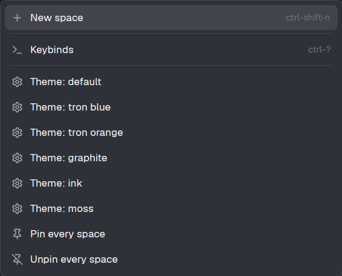

# Herdr menu

The menu that opens when the person right-clicks a space in the sidebar. A narrow dark panel appears next to the pointer, 230 pixels wide, holding one row per command for that one space: Rename, the worktree commands when the space is a git checkout, Pin space, Icon and colour…, Notes…, Claude (no permissions) and Close. Every row carries a small muted glyph on the left and, on the right, the global key bound to that command — "shift-f2" beside Rename. The panel takes the keyboard the moment it opens: the arrow keys walk a highlighted row, Enter runs it, Esc closes it. Nothing about agents appears here — this is a list of commands, and the only colours in it are the theme's panel, border and text colours.



**What you see:**

The panel is a popup, not a block in the layout: Herdr draws its own frame around it (border, rounded corners, shadow) because the overlay is opened without `frame: "none"`. The size comes from whoever opens it — the sidebar opens it 230x320 — and a popup is as tall as its items, so the height is only the cap.

Top to bottom:

- **The panel.** 5px of padding on every side, filled with `theme().popover`, its text at 12.8px. Under the theme in force now (atom-one-dark) that panel is `#2e3238`; under the tron-blue theme this project ships it is `#051b28`.
- **Rows.** Each row is 31px tall, with 8px of padding left and right, a 9px gap between its three parts and 7px rounded corners. A row holds:
  - a **glyph** on the left: a 14px SVG tinted `theme().muted` (`#9c9ea1` under atom-one-dark, `#6fb8d4` under tron-blue);
  - the **label** in `theme().foreground` (`#eeeeef` / `#b8ecff`) at 12.8px, taking the space that is left;
  - a **hint** on the right: 11px, `theme().dim` (`#6f7175` / `#3f7d97`), the global key bound to that command. It is empty where the command has no global key.
- **The separator above Close**: a 1px line in `theme().border` (`#ffffff18` / `#0d3a52`), inset 7px from each side, with 4px of space above and below it. It is the only separator in the space menu.
- **Two row tints, independent of each other.** The row under the pointer takes `theme().hover` (`#ffffff0e` / `#0a2c3e`); the row under the keyboard cursor takes `theme().selected` (`#ffffff17` / `#0d3547`). Hovering does not move the keyboard cursor.

The rows of the space menu, in order, with the glyph each one draws and the hint beside it:

| Row | Glyph | Hint |
| --- | --- | --- |
| Rename | `mods/workspace-chrome/square-pen.svg` | shift-f2 |
| New worktree | `mods/workspace-chrome/git-branch.svg` | (none) |
| Open worktree | `mods/workspace-chrome/git-branch.svg` | (none) |
| Remove worktree | `mods/workspace-chrome/git-branch.svg` | (none) |
| Pin space *(or "Unpin space" when the space is pinned)* | `mods/workspace-chrome/pin.svg` | (none) |
| Icon and colour… | `mods/herdr-dock/palette.svg` | (none) |
| Notes… | `mods/workspace-chrome/file-text.svg` | (none) |
| Claude (no permissions) | `mods/workspace-chrome/terminal.svg` | (none) |
| Close *(or "Close (pinned — unpin first)" when the space is pinned)* | `mods/workspace-chrome/x.svg` | (none) |

The worktree rows depend on the space's checkout: a space whose folder is not a git repository shows only six rows (Rename, Pin space, Icon and colour…, Notes…, Claude (no permissions), Close); a space that is a repo's own checkout shows eight (no "Remove worktree"); a space that is a linked worktree shows all nine. Six rows make a panel 205px tall, eight make 267px, nine make 298px — 31px a row, plus 9px for the separator, plus 10px of padding — so every row fits inside the 320px cap.

**How it behaves:**

- **Opening.** The person right-clicks a space row in the sidebar. The menu opens as a popup and takes the keyboard as it opens.
- **Keys.** Down and Up move the cursor, wrapping round at both ends; Enter runs the row under the cursor; Esc closes the menu and runs nothing. The cursor starts on the first row. No other key does anything.
- **Mouse.** Hovering tints a row; clicking a row runs it and closes the menu. Hover never moves the keyboard cursor.
- **The git check.** Two `git rev-parse` calls run in the background while the menu is open, in the space's live folder on that space's machine. Until they answer, the worktree rows are missing; when they answer, the rows appear and the panel grows.
- **Agent status is not shown in this menu.** No working, blocked, done or idle mark appears anywhere in it: a space's status is not shown, and the rows are the same whether the space has agents running or not. The menu also never names the space it is acting on.
- **Rename** runs `space.rename` for that space; Herdr asks for the new name.
- **New worktree / Open worktree / Remove worktree** open the shipped worktree mod as a dialog — 560x480 for "Open worktree", 440x260 for the other two — carrying the space and which of the three it was.
- **Pin space / Unpin space** add or remove the space's id in the shared list of pinned spaces (the same list the sidebar reads), then close the menu.
- **Icon and colour…** closes the menu and opens the Space look dialog (430x600) for that space.
- **Notes…** closes the menu and opens the Notes dialog (480x580) for that space.
- **Claude (no permissions)** closes the menu and starts a new tab named "Claude" in that space, running `claude --dangerously-skip-permissions`.
- **Close** closes the menu and asks Herdr to close the space; Herdr asks for confirmation first, because the command is run without `confirmed`.
- **Close (pinned — unpin first)** does *not* close the menu: it posts a warning notification — title "This space is pinned", body "Unpin it first, then close it.", level warning — and the menu stays open with the space still there.
- **Nothing moves on its own.** The panel is not animated and no timer runs in it. The only thing that changes after it opens is the worktree rows arriving.

**Built from:**

- **The layout.** `layouts/herdr.json`, the person's own layout. The menu is **not** in it — it is an overlay the sidebar opens:

  ```
  root (row, background canvas, divider 1px border, titlebar none)
  ├── sidebar (column, 268px, min 44, max 480, background chrome, resizable false)
  │   ├── brand (block, mod workspace-chrome, 46px, window_drag)
  │   ├── sidebar-lists (column)
  │   │   ├── spaces (block, mod herdr-spaces, weight 1, min 90)   ← opens this mod
  │   │   └── agents (block, mod herdr-agents, weight 1, min 90)
  │   ├── dock (block, mod herdr-dock, 42px)
  │   └── sidebar-footer (block, mod workspace-chrome, props footer, 69px)
  ├── work (column, resizable false)
  │   ├── tabs (block, mod herdr-tabs, 42px, window_drag)
  │   ├── work-body (row, padding 8, gap 8)
  │   │   ├── main (block, tab active, pane header herdr-pane 30px top, focus #3fae6a)
  │   │   └── panel (column, 368px, min 280, max 900, hidden)
  │   └── status (block, mod workspace-status, 28px)
  ├── b037df0d… (block, mod pungitore-panel, 320px)
  └── b9551b73… (block, mod zz-dump, 200px)
  ```

  `mods/herdr-spaces/main.js` opens it from a space row's right-click: `openOverlay({mod: "herdr-menu", kind: "popup", width: 230, height: 320, props: {tab: "space", target: {id}}})`.
- **The mod itself.** `mods/herdr-menu/main.js` (224 lines) and `mods/herdr-menu/mod.json`, which is `{ "place": "none", "cloned_from": { "name": "menu", "version": "0.1.16" } }` — `"place": "none"` means the mod appears only where another mod or a layout puts it, here only as an overlay. It is Herdr's shipped `menu` mod at version 0.1.16 with these changes: the space branch gained Pin space, Icon and colour…, Notes… and Claude (no permissions), and a pinned space's Close became "Close (pinned — unpin first)"; the general list gained "Theme: default" (still atom-one-dark), "Theme: tron blue", "Theme: tron orange", "Pin every space" and "Unpin every space", and lost the shipped "Theme: atom one dark"; and the mod now reads and writes shared state and posts notifications, which the shipped one does not.
- **Props and their roles.** `props().tab` says which menu this is — "pane", "tab", "space", or anything else for the general list. `props().target` names the thing acted on: `{id}` for a space, `{id, space}` for a tab, `{pane, terminal}` for a pane. `props().overlay` is the id of this popup, the one handed to `closeOverlay`.
- **`herdr` functions it calls.** `run(name, args)`, `props()`, `closeOverlay(id)`, `openOverlay(spec)`, `theme()`, `keys()`, `terminals()`, `spaces()`, `panes()`, `exec(cmd, args, {cwd, on})`, `shared(key)`, `setShared(key, value)`, `notify({title, body, level})`.
- **Commands it runs.** `space.rename {id}`, `space.close {id}`, `space.new {}`, `tab.new {name, space, argv}`, `tab.rename {id}`, `tab.new {space}`, `tab.close {id}`, `pane.split {direction, pane}`, `pane.zoom {pane}`, `pane.close {pane}`, `terminal.right_click {terminal, to}`, `terminal.park {terminal}`, `app.help {}`, `app.theme {name}` with the names `atom-one-dark`, `tron-blue`, `tron-orange`, `graphite`, `ink` and `moss`.
- **Its own pseudo-commands** — not app commands, handled inside the mod's `choose()`: `herdr.pin`, `herdr.pin.all`, `herdr.unpin.all`, `herdr.look`, `herdr.notes`, `herdr.claude`, `herdr.pinned.close`, and `worktree` (which opens a dialog instead of running a command).
- **Overlays it opens.** `worktree` as a dialog (560x480 for "open", 440x260 for "new" and "remove") with `props {space, action}`; `herdr-look` as a dialog 430x600 with `props {space}`; `herdr-notes` as a dialog 480x580 with `props {space}`.
- **Programs it runs.** `git rev-parse --show-toplevel` and `git rev-parse --path-format=absolute --git-common-dir`, each with `{cwd, on}` so a space on another machine is asked there. The first gives the checkout's root, the second says whether the space is the repo's own checkout ("main") or a linked worktree ("linked"); a folder that is not a repository gives no worktree rows at all.
- **Its art.** `mods/workspace-chrome/`: `square-pen.svg` (rename), `git-branch.svg` (the worktree rows), `pin.svg` (pin), `pin-off.svg` (unpin every space), `file-text.svg` (notes), `terminal.svg` (Claude), `x.svg` (close), `plus.svg` (new), `settings.svg` (the theme rows), `panel-right.svg` (split), `square.svg` (zoom). `mods/herdr-dock/palette.svg` (icon and colour). Every path starts at `mods/`, so they are resolved from `~/.config/herdr-app`, not from the mod's own folder.
- **Shared state.** `herdr.pinned` (the ids of pinned spaces) and `herdr.pinNew` (true while every space is pinned) — the same keys `herdr-spaces` and `herdr-dock` read.

**Watch out:**

- **Three of the four menus in this mod never open.** Only the space branch runs: herdr-spaces opens `herdr-menu`, but herdr-tabs (`mods/herdr-tabs/main.js:142`) still opens the *shipped* `menu` mod for a tab's right-click, and the pane branch needs a `terminal_menu` block in the layout, which `layouts/herdr.json` does not have. Nothing at all opens the general list (New space, Keybinds, the six themes, Pin every space, Unpin every space). A build that only ever exercises the space menu has exercised a quarter of this mod.
- **Most of the glyphs live in a mod that is not in this project.** `mods/workspace-chrome/*.svg` is a path under `~/.config/herdr-app`, and the workspace-chrome mod is shipped — it lives in `~/.config/herdr-app/mods`, not in this repo's `mods/`. So a build that copies only this repo gets no glyph at all on any row but "Icon and colour…" (`mods/herdr-dock/palette.svg`, which is in this repo), and a worktree dialog that never opens, because the shipped `worktree` mod is missing too — while the worktree rows still appear.
- **The git check is one-shot and late.** The result is taken once, when the menu opens, and never refreshed; the worktree rows appear when it answers, or never. Git older than 2.31 has no `--path-format=absolute`, so the check fails and there are no worktree rows. The keyboard cursor is an index into the row list, and the list grows under it: if the person presses Down twice before the check answers, the highlighted row is not the one they moved to.
- **The check runs on the space's machine.** The folder is the cwd of the first pane of one of the space's tabs, else the space's own folder; on a remote space that is a round trip, and the menu opens without the worktree rows while it waits.
- **The pinned state is shared with the sidebar** under `herdr.pinned` (and `herdr.pinNew`). Right now every space is pinned and `herdr.pinNew` is true, so every space menu reads "Unpin space" and "Close (pinned — unpin first)" and never shows a plain "Close". A space that is not pinned reads "Pin space" and "Close".
- **"Unpin space" draws the same pin glyph as "Pin space".** The crossed-out pin (`pin-off.svg`) is used only by "Unpin every space", in the general list that never opens.
- **"Close" is run without `confirmed`**, so Herdr asks before it closes anything; the worktree mod, which closes a space for certain, passes `confirmed: true`. The pinned variant never runs the command at all — it only warns.
- **The hint reads only the "global" section of keys.json**, and the first match wins. Rename shows "shift-f2"; Keybinds would show "ctrl-?"; "Close", the worktree rows, the theme rows and every herdr.* row show nothing. "Pin space" shows nothing even though the dock's pin button is bound to ctrl-shift-i — that key binds the action `herdr-dock.pin`, a different name.
- **The hint matches on the first argument's value**, which works only because the discriminant comes first: `pane.split {direction: "right"}` matches the binding `pane.split:right`. For a command whose first argument is an id (space.rename, tab.rename, space.close) only the bare action name can ever match.
- **The size belongs to the caller, not to the mod.** 230x320 comes from herdr-spaces. The general list, if it were ever opened, would need 338px — 10 rows, 2 separators and the padding — more than the 320px cap, and the menu has no scrolling, so the bottom rows would be cut off.
- **The element ids collide with the shipped menu.** This mod names its root "menu" and its rows "mi-0", "mi-1", … — the same names the shipped `menu` mod uses, so two copies open at once carry duplicate ids.
- **The labels carry typographic punctuation:** "Icon and colour…" and "Notes…" end in an ellipsis character, and "Close (pinned — unpin first)" contains an em dash. They are not three dots and not a hyphen.
- **`herdr-app check` never reaches the git check.** It loads the mod with no props, so `props().tab` is not "space" and no `exec("git", …)` runs; the check passes with no warnings. What it renders once is the general list (New space, Keybinds, the six themes, Pin every space, Unpin every space) — the only branch a check ever exercises.

**Done when:**

- `herdr-app check ~/.config/herdr-app/mods/herdr-menu` exits 0 with "check passed".
- Right-clicking a space row in the sidebar opens a popup 230px wide whose rows are exactly: Rename, New worktree, Open worktree, Pin space, Icon and colour…, Notes…, Claude (no permissions), Close — plus "Remove worktree" when the space is a linked worktree — with a 1px separator above Close and every row visible inside the 320px cap.
- In a space whose folder is not a git repository the three worktree rows are absent and six rows remain.
- Down and Up move a lighter band down and up the rows, wrapping at the ends; Enter on Rename asks for a name and the space is renamed in the sidebar; the hint beside Rename reads "shift-f2".
- Esc closes the popup without running anything.
- Choosing "Pin space" pins that space in the sidebar; reopening the menu on it reads "Unpin space" and "Close (pinned — unpin first)" instead of "Close".
- Choosing "Close (pinned — unpin first)" posts the warning "This space is pinned — Unpin it first, then close it." and leaves the popup open, with the space still in the sidebar.
- Choosing "Icon and colour…" opens the Space look dialog (430x600) with that space's name in it; "Notes…" opens the Notes dialog (480x580).
- Choosing "Claude (no permissions)" opens a new tab named "Claude" in that space, running `claude --dangerously-skip-permissions`.
- Clicking a row with the mouse runs it just as the keyboard does: clicking "Notes…" opens the Notes dialog.
