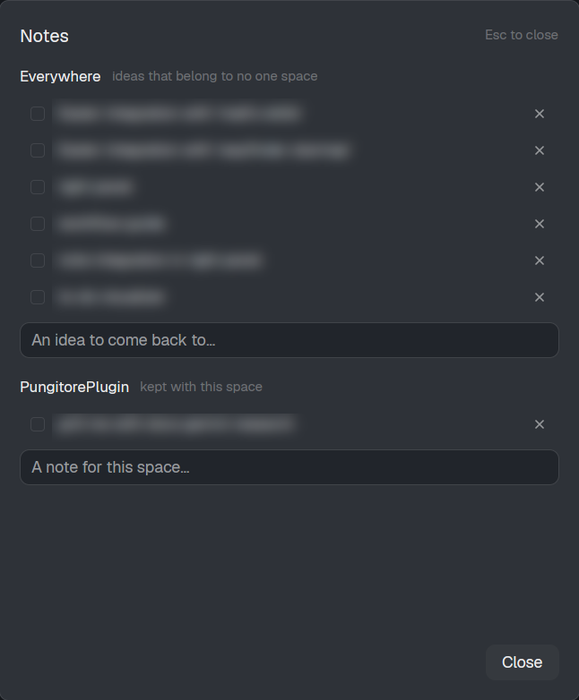

# Notes

The window that opens when you want to remember something: a to-do list and a note pad in one dialog of 480x580, centred in the Herdr window with the window behind it dimmed. It holds two lists. "Everywhere" is the ideas that belong to no one space; below it, under the name of the space you are in, are the notes kept with that space. Every line is a small square box to tick, the text of the note, and a thin × at the far right to throw the line away; clicking the text turns it into a field so it can be rewritten where it stands. Under each list is a field to type a new note into, and Enter puts it at the bottom of that list. The notes live in Herdr's shared store, so they are still there after a restart and every copy of this mod sees the same list.



**What you see:**

The dialog is 480x580, centred in the window. Herdr draws the frame around it (border, rounded corners, shadow) because the mod does not ask for `frame: "none"`; the mod paints its own surface over it, `theme().popover` with its own 8px corners, and 16px of padding all round. Body text is 13px.

The colours below are the ones of `atom-one-dark`, the theme in use: `popover` `#2e3238` (the dialog surface), `background` `#21252b`, `foreground` `#eeeeef`, `dim` `#6f7175`, `border` `#ffffff18`, `input` `#ffffff24`, `hover` `#ffffff0e`, `raised` `#35393e`, `accent` `#61afef`, `done` `#61afef`, `blocked` `#e06c75`.

Top to bottom:

- **The header row.** "Notes" in 15px semibold `theme().foreground` on the left; on the right, at the far edge, "Esc to close" in 11px `theme().dim`. 12px below the header starts the list.
- **The list area**, the only part that scrolls (the scrollbar appears only when there is more to scroll to). It holds the two sections, 14px apart.
  - **A section head**, 7px above its list: the title in 12.5px semibold `theme().foreground`, then 8px later the hint in 11px `theme().dim`.
    - The first is **"Everywhere"**, with the hint "ideas that belong to no one space".
    - The second is **the name of the space** the dialog was opened for (say "Herdr"), with the hint "kept with this space". With no space open at all it reads "This space".
  - **A note line**, at least 28px tall, 6px of padding at each side, 8px between the parts, corners rounded 7. Under the pointer the whole line takes `theme().hover`.
    - **The box**: an 18px-wide slot holding a 12x12 square, corners rounded 3, with a 1px border. Unticked it is bordered in `theme().border` and filled with `theme().popover`, so it reads as an empty square outline on the dialog. Ticked it is filled with `theme().done` and carries a 9px `mods/workspace-chrome/check.svg` tick in `theme().background` — a dark tick on blue in this theme.
    - **The text**: 12.5px. Unticked, `theme().foreground`; ticked, `theme().dim`. It is cut with an ellipsis when it is too long for the line ("Make each agent live under its space, so you can close the agen…").
    - **The ×**: a 20px-wide slot at the right holding a 12px `mods/workspace-chrome/x.svg`, always drawn at 55% opacity; under the pointer it goes to full opacity and takes `theme().blocked`.
  - **Lines are 2px apart** from each other.
  - **An empty list** reads "Nothing here yet." in 11.5px `theme().dim`, with 2px of padding at the left and 4px above and below.
  - **The field for a new note**, 7px under the list: 30px tall, 9px of padding at each side, corners rounded 8, a 1px `theme().input` border and a `theme().background` fill. The first one shows "An idea to come back to…", the second "A note for this space…".
- **The footer**, below the scrolling area and always in place: the **Close** button on the right — 30px tall, 13px of padding at each side, corners rounded 8, filled with `theme().raised`, its label in `theme().foreground`; under the pointer it goes to 90% opacity.

**How it behaves:**

- **No agent status is shown anywhere in this dialog.** There are no `working`, `blocked`, `done` or `idle` marks, because there are no agents in it. The tick on a note is a to-do box, not an agent status, even though it borrows the same colour token: a ticked note is filled with `theme().done` (`#61afef` in `atom-one-dark` — the same blue as `theme().accent`; in `graphite` it is `#76a8ff`). The only other status-coloured thing is the ×, which turns `theme().blocked` under the pointer.
- **Type in a field and press Enter** to add the note: it is trimmed, appended at the bottom of that list, and the field is cleared. Whitespace alone adds nothing.
- **Click the box** to tick a note and untick it again. The text goes dim when it is ticked and back to `theme().foreground` when it is not.
- **Click the text** of a note to rewrite it: the text becomes a field 24px tall with a 1px `theme().accent` border. Enter saves it, and clicking away saves it too; the text is trimmed before it is written. Only one note is being edited at a time.
- **Click the ×** to delete the note. There is no confirmation and no undo.
- **Escape closes the dialog**, as does the Close button, as does a click beside it (the dialog is not `modal: true`). Nothing inside the dialog moves: it stays centred at 480x580 and cannot be dragged.
- **The list never re-orders.** New notes go to the bottom, ticked notes stay where they are, and there is no limit on how many there may be.
- **The list scrolls** when there are more lines than fit.
- **Both lists are the same everywhere.** The store is shared, so a second copy of this dialog (on another space, or in a second window on this computer) shows the same lines, and adding a line in one is seen in the other at once.
- **Nothing polls.** The dialog redraws when Herdr's live data changes and when any shared value is set; there is no timer of its own.

**Built from:**

- **The layout.** `layouts/herdr.json`, the user's own layout. The notes mod has **no block in it** — it is not part of the standing layout, only an overlay:

  ```
  root (row, background canvas, divider 1px border, titlebar none)
  ├── sidebar (column, 268px, min 44, max 480, background chrome, resizable false)
  │   ├── brand (block, mod workspace-chrome, 46px, window_drag)
  │   ├── sidebar-lists (column)
  │   │   ├── spaces (block, mod herdr-spaces, weight 1, min 90)
  │   │   └── agents (block, mod herdr-agents, weight 1, min 90)
  │   ├── dock (block, mod herdr-dock, 42px)
  │   └── sidebar-footer (block, mod workspace-chrome, props footer, 69px)
  ├── work (column, resizable false)
  │   ├── tabs (block, mod herdr-tabs, 42px, window_drag)
  │   ├── work-body (row, padding 8, gap 8)
  │   │   ├── main (block, tab active, pane header herdr-pane 30px top, focus #3fae6a)
  │   │   └── panel (column, 368px, min 280, max 900, hidden)
  │   └── status (block, mod workspace-status, 28px)
  └── b037df0d… (block, mod pungitore-panel, 320px)
  ```

  `mods/herdr-notes/mod.json` is `{ "place": "none", "title": "Notes" }` — `"place": "none"` means it appears only where a layout or another mod puts it, which here means only as an overlay. There is no `"overlay"` block in it (see **Watch out**).
- **How it is opened.** Three places, and all three open the same thing: `openOverlay({ mod: "herdr-notes", kind: "dialog", width: 480, height: 580, props: { space: <space id> } })`.
  - `mods/herdr-dock/main.js` — the 26x26 notes button in the sidebar dock bar (`mods/herdr-dock/notes.svg` at 14px in `theme().muted`, tooltip "Notes"), and the key `ctrl-shift-d` bound to `herdr-dock.notes`. It passes the **active** space: `spaces().find((s) => s.active)?.id`.
  - `mods/herdr-menu/main.js` — the "Notes…" item in a space's right-click menu (icon `mods/workspace-chrome/file-text.svg`), which closes the menu first. It passes the id of the space that was clicked.
  - `mods/herdr-spaces/main.js` — the third hover button on a space row in the sidebar (`space-notes-<id>`, `mods/workspace-chrome/file-text.svg`, tooltip "Notes for this space"). It passes that space's id.
- **The mod itself.** `mods/herdr-notes/main.js`, a class `Notes extends View` (from `gpui-kit`) with `init(props, cx)` and `render(cx)`. It imports `View`, `div`, `svg` from `gpui-kit`; `v_flex`, `h_flex`, `InputState`, `Input` from `gpui-base`; and `props`, `theme`, `spaces`, `shared`, `setShared`, `closeOverlay` from `herdr`.
  - `props()` gives `{ space, overlay }`: the space id to show and the overlay's own id, which is what `closeOverlay` is given to close the dialog.
  - `theme()` gives the colours; `spaces()` gives the space name for the second section head (the space whose id matches `props().space`, else the active one).
  - `shared("herdr.notes")` and `setShared("herdr.notes", v)` read and write the list.
- **`herdr` functions it calls.** `props()`, `theme()`, `spaces()`, `shared(key)`, `setShared(key, value)`, `closeOverlay(id)`. That is all.
- **Commands it runs.** None. It never calls `run()`; it changes no space, tab, pane or terminal.
- **Programs it runs.** None. It starts no agent and touches no file.
- **Its art.** `mods/workspace-chrome/check.svg` (the tick, 9px) and `mods/workspace-chrome/x.svg` (the delete cross, 12px) — both from another mod's folder, not its own.
- **Its storage.** The shared key `herdr.notes`:

  ```json
  { "global": [ { "id": "…", "text": "…", "done": false } ],
    "spaces": { "<space id>": [ { "id": "…", "text": "…", "done": false } ] } }
  ```

  New ids are `Date.now().toString(36)` plus four random characters. Every read copies the items; every change writes the whole store back, which re-renders every mod in the app.
- **Where the first notes come from.** Not from this mod. `mods/herdr-dock/main.js` seeds the store once, if it is empty, with two global notes: "Easier integration with 'matt's skills'" and "Easier integration with 'wayfinder starmap'".

**Watch out:**

- **The dialog renders empty when it is opened without a size.** `mod.json` has no `"overlay"` block, so `mod.open herdr-notes` (from the command palette) opens it content-sized: about 424x112, with only the title, "Esc to close" and the Close button. The body is `v_flex().flex_1().min_h(0)` inside a `size_full()` root, so when the overlay has no height to give, it collapses to nothing and both lists and both fields vanish. This was seen in the running app, not worked out on paper. Every other way in (the dock, the space menu, the space row) asks for 480x580, so they are fine. The fix is one line in `mod.json` — `"overlay": { "width": 480, "height": 580 }`, as `mods/herdr-look/mod.json` already does — or always opening the mod with an explicit width and height.
- **A note cannot be emptied.** `saveEdit` returns early when the trimmed text is empty, so an edit box that has been cleared is never written back: the note keeps its old text, and the empty box stays open. There is no cancel button and no Escape-to-cancel either. Put something back, or click another note to abandon the edit silently.
- **The field for a new note is inside the scrolling area**, not pinned to the bottom of its section. With a long list you have to scroll down to reach it. Only the Close button is pinned.
- **Which space you see follows `props().space`,** so the dock (active space) and another space's menu show different second lists — and a note added under one space does not appear under "Everywhere".
- **The section head and the list can disagree.** The head falls back to the active space's name when `props().space` names a space that no longer exists, but the list still reads the stale id, so you can be shown the wrong space's name over the right space's notes.
- **With no space at all** the second section is headed "This space", and typing in its field adds nothing — `add` gives up when there is no space id and does not clear what you typed.
- **The mod never creates the list.** The two starter notes are the dock's doing; without the dock the list starts empty and reads "Nothing here yet.".
- **Deleting is instant and final.** The × throws a note away with no confirmation, and there is no undo.
- **Every change rewrites the whole store** and re-renders every mod in the app, since `setShared` re-renders all. A long list is copied item by item on every read.
- **The list is never trimmed or re-sorted**, so it grows for as long as you keep it.
- **The mod assumes other personal mods are installed:** `herdr-dock`, `herdr-menu` and `herdr-spaces` are the only ways in, and the tick and the cross come from `mods/workspace-chrome/`. Without them the dialog cannot be opened and its two glyphs are missing.
- **`herdr-app check ~/.config/herdr-app/mods/herdr-notes` passes cleanly** (exit 0, no warning): the mod calls no external program and writes no file. Its `init()` does not guard with `checking()`, but it only makes two `InputState`s and focuses a handle, which is harmless.
- The mod is not `"focusable": true`, so `pane.go` never lands on it. It focuses its own handle in `init()` and catches Escape on the root (`on_key_down` → `closeOverlay(props().overlay)`); Herdr also closes the top dialog on Escape of its own accord.

**Done when:**

- `herdr-app check ~/.config/herdr-app/mods/herdr-notes` exits 0 with no warning.
- Opening it from the dock's notes button (or with `ctrl-shift-d`) gives a 480x580 dialog in the middle of the window, the window behind it dimmed, with "Notes" at the top left, "Esc to close" at the top right and a "Close" button at the bottom right.
- On a machine where the dock has run, the first list is headed "Everywhere" and holds the two starter notes, "Easier integration with 'matt's skills'" and "Easier integration with 'wayfinder starmap'"; the second is headed with the name of the active space and the hint "kept with this space".
- Typing "hello" in "An idea to come back to…" and pressing Enter adds a line "hello" at the bottom of "Everywhere" and empties the field; typing only spaces adds nothing.
- Clicking the box beside a note fills it with `theme().done` and puts a dark tick in it, and the note's text goes `theme().dim`; clicking it again puts the text back to `theme().foreground`.
- Clicking a note's text turns it into a 24px field with a `theme().accent` border; typing "buy milk" and pressing Enter rewrites the line with the text trimmed.
- Clicking the × on a line removes that line at once, with no dialog asking.
- Opening the same dialog from another space's menu shows a different second list, and a note added there does not turn up under "Everywhere".
- A note added to a space is still there after Herdr is restarted, and it is still there in a second copy of the dialog.
- Pressing Escape closes the dialog, and so does the Close button.
- A list long enough to overflow the dialog scrolls, and the field for a new note scrolls with it.
