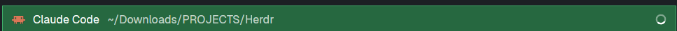

# Pane header

A 30px strip across the top of every pane, filled with the colour of the space the pane lives in, darkened 40% so the white letters read on it. From the left: the program's icon, the program's name (or the terminal's title, for anything that is not an agent or a shell), the folder, and the agent's status mark if there is one. Hovering the strip brings out four buttons on the right — split right, split down, zoom, close — and clicking anywhere else on the strip focuses the pane. The frame drawn around the focused pane wears the same space's colour, in its undarkened form.



**What you see:**

The strip is the `pane.header` of the `main` block in `layouts/herdr.json`: 30px tall, at the top of the pane (`"position": "top"`), and always shown (`"reveal": "always"`), so the terminal below it starts 30px down. It is drawn inside the pane's frame — 1px, square corners (`"radius": 0`), 8px between panes (`"gap": 8`), and `"lone": true` so the frame is drawn even when the tab has a single pane.

- **The strip itself.** One row: 10px of padding at each end, 8px between items, everything centred vertically, text 12px. The fill is the space's own colour darkened 40%. The six space colours are `ansi6` `#22a99a`, `ansi3` `#e3814f`, `ansi4` `#5b8def`, `ansi5` `#8b7cf6`, `ansi2` `#3fae6a`, `ansi1` `#d9649a`; darkened 40% they are `#14655c`, `#884d2f`, `#37558f`, `#534a94`, `#266840`, `#823c5c`. A colour picked by hand (`#rrggbb`) is darkened the same way (`#e2564a` → `#88342c`). A space with no colour of its own wears the `ansi6` teal `#14655c`.
- **The rule under it.** 1px in `theme().border`, on the edge that faces the terminal. With `"position": "bottom"` in the layout the rule moves to the top edge instead.
- **The icon.** 14x14, the program's own icon from the program table: `svg(icon)` tinted with the text colour when the table says the icon is one colour, otherwise `image(icon)` in its own colours. On the coloured strip it is drawn in white at 75% (`#ffffffc0`). A pane that holds a mod rather than a terminal has no icon.
- **The name.** 12px, medium weight, white (`#ffffff`), cut off with an ellipsis, never wider than 260px. It is the program name for an agent ("Claude Code") or a shell ("zsh"); for any other program it is the terminal's title, that is, whatever the program set (the file open in Neovim, say); failing that the program name; failing that "shell".
- **The folder.** 12px, white at 72% (`#ffffffb8`), taking all the width left over and cut off with an ellipsis. Home is `~`, a folder under home is `~/path`, anything else is the whole path. Empty for a pane that holds a mod.
- **The status mark**, only when the pane's own program reports one:
  - **working**: a 12px arc (`mods/workspace-chrome/spinner.svg`) turning once every 900ms, in white.
  - **blocked**: a pill 18px tall, 6px of padding at each end, black at 27% (`#00000045`) behind "Needs you" in 10.5px bold white.
  - **done**: a 7x7 white square.
  - **idle**: nothing at all.
- **The four buttons**, on the right, only while the pointer is on the strip: split right, split down, zoom (or unzoom, when the pane is zoomed), close. Each is a 20x20 square — a 14px glyph with 3px of padding — with the glyph in white at 75% (`#ffffffc0`). Under the pointer the square takes white at 20% (`#ffffff33`) and the glyph goes to full white. Nothing in the strip has rounded corners.

**How it behaves:**

- **Every status has its own look**, as above. The mark is the *pane's* status, not the space's and not the tab's: a shell pane shows nothing, and a pane whose agent is `idle` shows nothing either. `done` means the agent finished while you were looking away; the moment you look at it, it becomes `idle` and the square goes away.
- **Only the spinner moves.** It is a native animation (`svg(...).spin(900)`), not a redraw loop; the strip itself never shifts, resizes or reflows when a status changes — the mark simply appears or disappears at the right end.
- **Click the strip** and the pane takes the keyboard (`pane.focus` with that pane). The click lands on the name and the folder too, not only on the empty space between them.
- **Hover the strip** and the four buttons come out. They are laid out in the strip, so the name and the folder give up the width for them (the folder is the one that shrinks; the name keeps its 260px).
  - **split right** / **split down** (`pane.split {direction, pane}`): a new pane opens beside this one, with the space's default shell — it does not copy the program running in the pane you split from.
  - **zoom** / **unzoom** (`pane.zoom {pane}`): the pane takes the whole tab. The glyph is the arrows-in (`zoom.svg`) until the pane is zoomed, then the arrows-out (`unzoom.svg`). Zooming also focuses the pane. A tab with a single pane has nothing to zoom over.
  - **close** (`pane.close {pane}`): the pane goes, and with it its terminal.
  - The buttons stop the click from reaching the strip, so pressing one does not also focus the pane.
- **The frame follows the space in front.** Within two seconds of switching spaces, the border drawn around the focused pane turns that space's colour in its undarkened form (`#22a99a` for `ansi6`), and the layout file on disk is rewritten to say so. An unfocused pane's frame stays 1px `theme().border`.
- **The strip's own colour is the space of the pane's tab**, which is normally the same space as the frame, since the block shows the front tab (`"tab": "active"`).
- **The mod binds no keys of its own.** The app's keys do the same things to the focused pane: `ctrl-shift-o` split right, `ctrl-shift-e` split down, `ctrl-shift-z` zoom, `ctrl-shift-x` close, `alt-h`/`alt-j`/`alt-k`/`alt-l` move between panes, `alt-shift-h`/`alt-shift-j`/`alt-shift-k`/`alt-shift-l` swap them.
- **One copy of the mod per pane.** A copy for a pane in a tab you are not looking at stays alive, keeps its own timer, and comes back as it was.

**Built from:**

- **The layout.** `layouts/herdr.json`, the person's own layout (a clone of Herdr's shipped `main`):

  ```
  root (row, background canvas, divider 1px border, titlebar none)
  ├── sidebar (column, 268px, min 44, max 480, background chrome, resizable false)
  │   ├── brand (block, mod workspace-chrome, 46px, window_drag)
  │   ├── sidebar-lists (column)
  │   │   ├── spaces (block, mod herdr-spaces, weight 1, min 90)
  │   │   └── agents (block, mod herdr-agents, weight 1, min 90)
  │   ├── dock (block, mod herdr-dock, 42px)
  │   └── sidebar-footer (block, mod workspace-chrome, props footer, 69px)
  ├── work (column, resizable false)
  │   ├── tabs (block, mod herdr-tabs, 42px, window_drag)
  │   ├── work-body (row, padding 8, gap 8)
  │   │   ├── main (block, tab active)                            ← this mod
  │   │   │     pane.header: { mod herdr-pane, reveal always, height 30, position top }
  │   │   │     pane: background background, border 1px border, focus 1px #3fae6a,
  │   │   │           radius 0, gap 8, lone true
  │   │   └── panel (column, 368px, min 280, max 900, hidden)
  │   └── status (block, mod workspace-status, 28px)
  ├── b037df0d… (block, mod pungitore-panel, 320px)
  └── b9551b73… (block, mod zz-dump, 200px)
  ```

  The header block carries no props: `{ "mod": "herdr-pane" }`. The mod is told which pane it belongs to by the app: `props().pane` and `props().terminal`.
- **The mod itself.** `mods/herdr-pane/main.js`, a clone of Herdr's shipped `pane` mod (version 0.1.16), with these changes:
  - the strip is filled with the space's colour darkened 40% instead of `theme().background`, and all its text is white (`#ffffff`, `#ffffffb8`, `#ffffffc0`) instead of `theme().foreground` / `theme().dim` / `theme().working` / `theme().blocked` / `theme().done`;
  - every rounded corner is gone: the buttons lose `rounded(4)`, the "Needs you" pill loses `rounded(5)`, the done square loses `rounded(4)`;
  - the assets are read from `mods/herdr-pane/` instead of `mods/pane/`;
  - it reads the space's colour from shared state and **rewrites the layout file** so the pane frame wears it (the shipped mod does neither);
  - it starts a 2-second timer to keep that up (the shipped mod has no timer).
- **`mod.json`.** `{ "place": "none", "title": "Pane header", "cloned_from": { "name": "pane", "version": "0.1.16" } }` — `"place": "none"` means it appears only where a layout puts it.
- **`herdr` functions it calls.** `panes()`, `props()`, `spaces()`, `layout()`, `theme()`, `home()`, `shared(key)`, `run(name, args)`.
- **Commands it runs.** `pane.focus {pane}`, `pane.split {direction: "right"|"down", pane}`, `pane.zoom {pane}`, `pane.close {pane}`. All four pass the pane explicitly, so they work even when a layout terminal block holds the keyboard.
- **Files it touches.** It reads `~/.config/herdr-app/layouts/<shared("layout") ?? "herdr">.json` with `fs/promises`, and writes it back with `JSON.stringify(tree, null, 2)` when the pane frame's `focus.color` or `radius` is not what it wants. It runs no programs.
- **Its art.** `mods/herdr-pane/close.svg`, `split-down.svg`, `split-right.svg`, `unzoom.svg`, `zoom.svg` — 16px viewboxes, `stroke="currentColor"`, drawn at 14px. The spinner is not its own: it borrows `mods/workspace-chrome/spinner.svg` (a 24px arc). The program icon comes from the app's program table (`icons/<program>.svg`).
- **Shared state it reads.** `space.colors` (space id → a colour name like `ansi6` or a picked `#rrggbb`), the same key `herdr-spaces`, `herdr-agents`, `herdr-tabs` and `herdr-look` read, so the strip, the sidebar row and the tab agree on a space's colour; and `layout` (the name of the shown layout), the same key the app sets.

**Watch out:**

- **The mod rewrites the layout file on disk.** Every two seconds it reads `~/.config/herdr-app/layouts/herdr.json` and, if any `content.pane` frame in it has a `focus.color` other than the front space's colour or a `radius` other than 0, it writes the whole file back with `focus: {width: 1, color}` and `radius: 0` on it. Any hand edit to the pane frame's focus colour or radius is undone within two seconds. The file is also reformatted (2-space JSON) on every write. This is deliberate — Herdr applies `layouts/<name>.json` live, so the file is how the frame's colour is changed at all.
- **`paintFrame` walks the whole tree**, not just the block this mod is in: every `content.pane` frame in the layout file gets the same focus colour and radius. In `herdr.json` there is only one, so it does not show, but the function is not scoped.
- **The strip's colour and the frame's colour can come from different spaces.** The strip wears the colour of the space owning the pane's tab (`spaceOf`, found by looking for `p.tab` among the spaces' tabs); the frame wears the colour of the *front* space (`spaces().find(s => s.active)`). They are the same space in this layout, because the block shows the front tab. A pane whose tab is not in any space — a remote space's tab, whose ids carry a machine prefix — falls back to the front space's colour, so its strip would wear the wrong space's colour.
- **Two colours in flight can land in the wrong order.** `checkFrame` guards with `this.writing`, but it clears that flag when the write finishes, so a space change during a write starts a second write; the first may land last and leave the old colour in the file. The next tick fixes it.
- **`herdr-app check` runs `init()` for real and the mod never calls `checking()`.** The two-second timer therefore starts during a check, and a check uses empty shared state (`shared.json` is not read), so `shared("space.colors")` is undefined and every space falls back to the `ansi6` teal. A check that is still alive at the two-second mark writes `#22a99a` into the layout file's focus colour. The write goes through `fs.writeFile`, not Herdr's `writeTextFile`, so the app cannot warn about it.
- **The write is not atomic.** `fs.writeFile` truncates the layout file and then writes it; Herdr, watching the file, could read it between the two. The file is small enough that a torn read is unlikely, but it is not the app's own atomic save.
- **The mod writes while it renders.** `render` calls `checkFrame` when `tint !== this.color`, which spawns a task that writes a file. `this.color` holds the *front* space's colour while `tint` holds the *pane's* space's colour, so the two differ only in the odd case above; when they do differ, every render spawns another write.
- **One timer, one file read and one whole-window redraw per pane, every two seconds.** A copy of the mod exists for every pane, including the panes of tabs you are not looking at, and each one runs its own `cx.timer.every(2000)`; each tick ends in a `cx.notify()`, and every redraw of a mod redraws the whole window.
- **The spinner belongs to another mod.** `mods/workspace-chrome/spinner.svg` is shipped with Herdr's `workspace-chrome` mod. Without that folder, the "working" mark draws nothing.
- **The zoom button has nothing to zoom over in a one-pane tab.** `pane.zoom` on the only pane of a tab changes nothing visible, and the glyph stays the arrows-in.
- **Splitting does not copy the program.** `pane.split` is called with no `argv` and no `mod`, so the new pane opens the space's default shell, whatever was running in the pane you split from.
- **A shell pane says "zsh", not the terminal's title.** The name is the program name for anything the table marks as a shell or an agent, so a plain terminal shows the shell's name; the folder is what tells you where you are.
- **The status mark is the pane's own.** A space whose other tabs have a blocked agent does not mark this pane.
- **This works only in a layout file of the person's own.** Herdr replaces its own layouts whole on every start, and a shipped layout file that has been edited is moved aside to `<name>-edited` on the next start, so the colour the mod writes would be lost. `herdr.json` is a clone of `main`, so it is the person's and it survives.
- **The repo copy and the installed copy drift apart.** The mod writes `~/.config/herdr-app/layouts/herdr.json`, not `Projects/Herdr/layouts/herdr.json`. They are identical right now, but every repaint of the frame's colour changes only the installed one.
- **Nothing in the strip is dead.** All four buttons run real commands, the click focuses the pane, and the status marks follow the pane's agent. The only thing that does nothing is the zoom on a lone pane, above.

**Done when:**

- `herdr-app check ~/.config/herdr-app/mods/herdr-pane` exits 0.
- With one space open whose colour is `ansi6`, the strip across the top of the pane is 30px tall and filled with `#14655c`, with a 1px `theme().border` rule under it, and the pane's frame around it is square (no rounded corners) with 8px between panes.
- The strip shows the program's icon at 14x14, the name in 12px medium white, and the folder in 12px white at 72% with `~` standing in for home.
- Clicking the strip focuses the pane: the pane's frame border turns the space's raw colour (`#22a99a` for `ansi6`) instead of `theme().border`, and the terminal takes the keyboard.
- Hovering the strip shows the four buttons in its right-hand end, each a 20x20 square with a white-at-75% glyph, and no rounded corners anywhere.
- Pressing split-right (or `ctrl-shift-o`) opens a second pane beside the focused one, with its own 30px strip in the same colour; the split pane holds the keyboard.
- Pressing close (or `ctrl-shift-x`) removes that pane and its terminal.
- Pressing zoom (or `ctrl-shift-z`) on a split pane makes it fill the tab, and the button's glyph becomes the arrows-out.
- An agent that is working shows the 12px arc turning; a blocked one shows the "Needs you" pill; one that finished while you were away shows the 7px white square; an idle one shows nothing.
- Switching to a space with a different colour changes the strip's fill within two seconds, and `~/.config/herdr-app/layouts/herdr.json` then reads `"focus": { "width": 1, "color": "<that space's colour>" }` — the raw colour, not the darkened one the strip wears.
- Setting `"radius": 6` in the pane frame of `herdr.json` by hand is undone within two seconds: the file goes back to `"radius": 0`.
