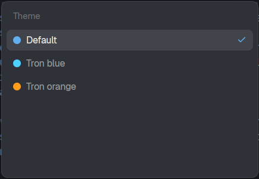

# Panel

The panel is a small popup that opens on demand from the bar at the bottom of Herdr's
sidebar. It has three faces. The **Theme** face lists three themes — Default, Tron blue and
Tron orange — each with a coloured dot; the theme in use is ticked and highlighted, and
clicking a row repaints the whole app and closes the popup. The **Usage** face reads the
MiniMax plan and shows two meters — the 5-hour window and, when the plan has one, the week —
each a 6px bar that runs from green through amber to red as the quota is used up, with the
percentage, the time the window ends and the time left under it, plus a line of the times
the credits last came back. The **Lessons** face lists the candidate lessons the Learning
Loop is waiting for a decision on, and offers the Learning Loop's own command to list them
again in more words. It shows one thing at a time: the face is chosen by the `panel`
prop it is opened with.

**What you see:**

Two popups, both drawn by Herdr's own frame (border, rounded corners, shadow) over the
window; the mod paints its own `popover` background and does not fill the popup's height, so
the content sits at the top of the frame.

*The theme face* (a 250×170 popup when the dock opens it; 320×220 if it is opened from
`mod.json`'s own overlay spec):

- The background is the theme's `popover` colour; the panel pads it by 6px.
- A heading **"Theme"** at 11px in the theme's `dim` colour, inset 8px from the left, 3px from
  the top and 5px above the list.
- Three rows, 26px tall, 6px corner radius, 8px of side padding, 7px between the parts of a
  row. A row in use is filled with the theme's `selected` colour; the others are not filled.
- At the left of each row a 10px round dot in the theme's own colour: **#61afef** for Default
  (`atom-one-dark`), **#4dd2ff** for Tron blue (`tron-blue`), **#ff9f1c** for Tron orange
  (`tron-orange`).
- The name at 11.5px — in the theme's `foreground` on the row in use, in its `muted` on the
  others: **Default**, **Tron blue**, **Tron orange**.
- On the row in use only, a 12px tick at the right in the theme's `accent` colour.

*The usage face* (a 320×220 popup):

- The background is the theme's `popover` colour; the panel pads it by 8px and leaves 6px
  between its blocks.
- A first line: **"MiniMax M"** at 11.5px in the theme's `muted` colour on the left, and the
  plan's model name on the right at 10px in `dim` (on this machine, `general`).
- A second line, **"How much of the plan is used."** at 10.5px in `dim`.
- One or two **meters**. A meter is: a label line with the label at 10.5px in `dim` on the
  left and the number at 10.5px in `foreground` on the right — **"23% used"**; then a 6px
  track with 3px corners, filled with the theme's `raised` colour where the quota is not
  spent; then a line at 10px in `dim` — **"resets 19:22 · 4h 59m left"**; then a second line
  at 10px in `dim` — **"window 14:22 → 19:22"**. The first meter is labelled **"5h window"**
  and its last line starts with the word **window**; the second is labelled **"this week"**
  and starts with **week**. When a window has already ended, the track is empty, the number
  reads **"0% used"** and the reset line reads **"quota back at 19:22 · waits for your next
  use"**.
- A last line at 10px in `dim`: the words **"credits back"**, then up to four clock times
  joined by **" · "** — the moments the credits came back.
- While the plan is being read: **"MiniMax M"** at 11.5px in `muted`, and **"Reading the
  plan…"** at 10.5px in `dim`. If the plan cannot be read: **"MiniMax M"**, and the error
  under it at 10.5px in `dim`.

*The lessons face* (a 420×460 popup):

- The background is the theme's `popover` colour; the panel pads it by 10px and leaves 8px
  between its blocks.
- A first line: **"Lessons to review"** at 12.5px in `foreground`, and at the right the count
  in 10.5px in `dim` — **"7 waiting"**.
- A second line at 10.5px in `dim`: **"Statements your sessions looked like lessons, waiting
  for a decision."**
- One card per candidate, filled with the theme's `raised` colour, 8px of side padding and 6px
  above and below, with 6px between the cards. Each card has two lines:
  - a first line with the candidate's id (**"C7"**) in 10.5px `dim` at the left, the folder it
    came from in 10.5px `dim` in the middle (cut off with an ellipsis), and the day it was
    staged (**"2026-11-18"**) at the right;
  - the lesson itself at 11px in `foreground`, cut off after 240 characters.
- While the candidates are being read: **"Reading the candidates…"** at 11.5px in `dim`. When
  there are none: **"Nothing is waiting: every candidate has been promoted or dismissed."**
- A **"Run the command"** button at the foot of the panel: 26px tall, 10px of padding, 6px
  rounded corners, filled with `raised`, the words in `foreground`. While the command runs it
  reads **"Running…"**.
- What the command printed appears above the button, in a box filled with `raised`, at 10px in
  `dim`, scrollable, at most 150px tall.

**How it behaves:**

- **The face is fixed at open time.** `props().panel` decides: `"usage"` gives the usage
  face, `"lessons"` the lessons face, anything else (including no prop at all) gives the
  theme face. It is not a toggle — nothing in the panel switches faces.
- **No agent statuses appear here.** The panel carries no agent list: it is about the
  MiniMax plan, not about the agents in the sidebar. The only status it shows is the quota's
  own: the bar's colour, from green (room to spare) through amber to red (nearly gone).
- **Clicking a theme row** runs `app.theme` with that theme's name, remembers the choice in
  the shared key `herdr.theme`, and closes the popup. The whole app — terminals, sidebar and
  panels — changes theme at once, and the popup is gone by the time the new colours arrive.
- **Hovering a theme row** fills it with the theme's `hover` colour. Nothing else in either
  face is hoverable, and nothing in the usage face is clickable: the bars look like controls
  but do nothing when clicked.
- **Keys:** only **Esc**, which Herdr closes popups with. The mod takes no focus, has no
  `on_key_down` and its `mod.json` does not say `"focusable": true`, so arrow keys and Enter
  do nothing to the theme list.
- **Nothing moves.** There are no timers and no animation in the panel: the usage face is a
  snapshot taken when the popup opened. The sidebar's dock re-reads the plan every 60 seconds
  and writes it to shared state, but the panel keeps the copy it took at open time, so an open
  panel does not tick over — close it and open it again to see new numbers. The lessons face
  is read once, when the popup opens, for the same reason.
- **The candidates are read from the staging files.** The Learning Loop stages a candidate
  lesson as a `### Cn — <timestamp> — pending` heading under
  `~/.claude/plugins/data/<plugin>/staging/*.md`, with the folder it came from in a
  `- cwd:` line. The panel walks those files itself and keeps only the headings that still
  say **pending** — the ones already promoted or dismissed are left out. The count the dock
  shows comes from the Learning Loop's own marker instead (ADR-0013); the two are read from
  different places on purpose.
- **"Run the command" runs the Learning Loop's own script.** The panel finds the newest
  installed version of the Learning Loop plugin under
  `~/.claude/plugins/cache/pungitore/pungitore-learning/<version>/scripts/staging.js` and runs
  it with the argument `list`, showing what it prints. If the Learning Loop is not installed
  the panel says so instead of failing silently.

**Built from:**

- **Where it sits.** It is not part of the standing layout: `mod.json` says
  `{"place": "none", "title": "Panel", "overlay": {"width": 320, "height": 220}}`, so Herdr
  never docks a copy of it. It appears only when something opens it as an overlay.
- **The layout it acts on** (`layouts/herdr.json`), a root `row` on the `canvas` background
  with a 1px `border` divider and no titlebar:
  - `sidebar`, a `column` 268px wide (min 44, max 480, `chrome` background, not resizable),
    holding `brand` (block, `workspace-chrome`, 46px, window_drag), `sidebar-lists`
    (`spaces` and `agents` blocks, each weight 1, min 90), **`dock` (block, `herdr-dock`,
    42px)** and `sidebar-footer` (block, `workspace-chrome` with `props: {footer: true}`,
    69px).
  - `work`, a `column` with `tabs` (block, `herdr-tabs`, 42px, window_drag), `work-body`
    (a `row`, padding 8, gap 8) holding `main` (the active tab's pane, whose header is
    `herdr-pane`, reveal always, 30px, position top, pane background `background`, 1px
    `border` border, a 1px `#3fae6a` focus edge, radius 0, gap 8, lone) and `panel`
    (a `column` 368px, min 280, max 900, `hidden: true`) whose `panel-body` is a `stack` of
    `files`, `changes` and `todos` with `files` active; then `status` (block,
    `workspace-status`, 28px).
  - The panel is opened by the **`herdr-dock` block in that sidebar**, and by nothing else:
    the palette button opens it as a 250×170 popup with `props: {panel: "theme"}`, the
    MiniMax bar as a 320×220 popup with `props: {panel: "usage"}`, and the lessons row as a
    420×460 popup with `props: {panel: "lessons"}`.
- **Props roles.** `props().panel` is `"theme"` or `"usage"` and picks the face.
  `props().overlay` is the id of the overlay this copy is showing, and is what
  `closeOverlay` is given to shut the popup.
- **The herdr functions it calls:** `theme()` for the colours, `themes()` for the list of
  themes `app.theme` accepts, `run("app.theme", {name})` to switch, `shared()` /
  `setShared()` for the three shared keys, `props()` for the face and the overlay id,
  `closeOverlay()` to dismiss itself, `exec()` to run `mmx` and the Learning Loop's script,
  `home()` for the home directory, and `checking()` so the mod does nothing during
  `herdr-app check`.
- **The one command it runs:** `app.theme {name}`, with `name` one of `atom-one-dark`,
  `tron-blue`, `tron-orange`.
- **The programs it runs:**
  - `mmx quota show --output json`, locally, with a 20000ms timeout. It reads
    `model_remains[]` and takes the first entry whose `model_name` matches
    `/m3|flash|general/i`, else the first entry. From it the panel takes
    `current_interval_remaining_percent`, `start_time`, `end_time`, and — unless
    `current_weekly_status` is 3, which means the plan has no weekly limit —
    `current_weekly_remaining_percent`, `weekly_start_time`, `weekly_end_time`.
  - `node <staging.js> list`, locally, with a 20000ms timeout, when the "Run the command"
    button is pressed.
- **The files it reads:** the staging files under `~/.claude/plugins/data/*/staging/*.md`,
  read with `fs/promises` (the `fs/promises` module is imported directly — it is not one of
  Herdr's functions).
- **Shared keys:** `herdr.theme` (the theme the person last chose), `herdr.usage` (the last
  plan read), `herdr.usageResets` (the windows seen, newest first, capped at 24, each
  `{start, end, at}`).
- **Its art.** The three 10px dots (#61afef, #4dd2ff, #ff9f1c) are drawn by the mod; the
  tick is the shipped `mods/workspace-chrome/check.svg`, a Lucide check tinted with
  `accent`. The bars are not gradients — boxes take no gradient — so each meter is 120
  slices of 1px-wide-each flexing space inside a 6px track: a slice is filled with the ramp
  colour where its position is within the used part, and with the theme's `raised` colour
  where it is not. The ramp is the mod's own and ignores the theme: `#3fae6a` green,
  `#d7b23a` amber, `#e2564a` red, mixed channel by channel so the whole track runs green →
  amber → red by position.
- **Element ids** (what `herdr-app status` and layout navigation see): `herdr-theme-panel`,
  `herdr-usage-panel` and `herdr-lessons-panel` on the three roots, `theme-<name>` on each
  theme row (`theme-atom-one-dark`, `theme-tron-blue`, `theme-tron-orange`), `meter-<label>`
  on each meter (`meter-5h window`, `meter-this week`), `candidate-<id>` on each candidate
  card and `lessons-run` on the button that runs the command.

**Watch out:**

- **Two sizes for one mod.** The dock asks for 250×170 for the theme face and 320×220 for
  the usage face, while `mod.json` says 320×220. Opening the panel through `mod.json`'s own
  overlay spec (or `mod.open`) therefore shows the **theme** face at 320×220, because no
  `panel` prop is passed and anything that is not `"usage"` falls through to the theme face.
- **The usage face needs `mmx` and a signed-in MiniMax account.** There is no fallback: if
  `mmx` is missing, times out (20s) or errors, the panel shows the error text under
  "MiniMax M" and no meters. The API key stays in `~/.mmx/config.json`; the mod never reads
  it.
- **The numbers do not update while the panel is open.** The panel reads
  `this.usage ?? shared("herdr.usage")`, and `this.usage` is set once when the popup opens,
  so the dock's 60-second refresh does not reach the open panel even though it updates the
  shared value. Closing and reopening is the refresh.
- **A failing read overwrites good shared state.** Opening the usage panel when `mmx` fails
  writes the error record over `herdr.usage`, so every mod reading that key sees the error
  until the dock's next tick (up to 60s) replaces it.
- **Only the theme rows do anything.** The usage meters have no click handler, no tooltip
  and no hover state, and the panel has no refresh button, no close button and no keyboard
  handling beyond Esc. There is no way to pick a theme other than by clicking its row, and no
  way to move the selection with the keyboard.
- **The tick depends on a colour match.** The panel works out which theme is in use by
  comparing the live theme's colours with each theme's across ten names — background,
  foreground, muted, accent, selection, border, canvas, surface, raised, input — and takes
  the closest only if it matches at least 95%. If nothing matches, it falls back to
  `herdr.theme`, the last theme the person chose. With a theme that is none of the three
  (Herdr's default is `graphite`) no row is marked at all until the person picks one.
- **The panel borrows another mod's art.** The tick comes from the shipped
  `workspace-chrome` mod's `check.svg`; the panel ships no SVG of its own, and if that asset
  goes the tick goes with it.
- **The code is duplicated from `herdr-dock`.** `inUse`, `mix`, `usedOf`, `ramp`, `plan`,
  `clock`, `remember` and the `RESETS` key are copied into this mod rather than shared, so
  the two copies have to be kept in step by hand; changing one does not change the other.
- **The bar's colours are the mod's own.** Green `#3fae6a`, amber `#d7b23a` and red
  `#e2564a` are fixed in the code and never follow the theme, on purpose.
- **The plan reports what is left, and the panel shows what is spent:** the number on the
  bar is `100 - current_interval_remaining_percent`, clamped to 0..100. If the plan sends no
  percentage, the meter shows only its label and an em dash — no bar, no reset line.
- **The weekly meter disappears** when `current_weekly_status` is 3 (no weekly limit on the
  plan), and the weekly window's third line then reads **week \<start\> → \<end\>**.
- **Times are the person's own clock.** A time today reads as **"19:22"**, tomorrow as
  **"Wed 19:22"**, and any other day as **"Fri 20 21:32"**.
- **It assumes the layout has the dock.** The panel can only be opened from a
  `herdr-dock` block in the sidebar (the layout has one, 42px, at the bottom of the
  268px `sidebar` column) or through `mod.open`. It also assumes `mmx` on the PATH of the
  machine the window is on — `exec` is called without `on`, so it always runs locally, never
  on the machine of a remote space.
- **The layout it acts on has one mod missing:** the `pungitore-panel` block points at
  `mods/pungitore-panel`, which is in this repository. `herdr-app status` reports no
  errors.
- **The lessons face needs the Learning Loop to be installed.** Without it the candidate
  list is empty and the panel says "Nothing is waiting: every candidate has been promoted
  or dismissed." — which reads as "there is nothing to do" rather than "there is nothing
  here to read". The dock's count is the honest signal: no row, no Learning Loop.
- **The candidate list is read at open time and never again.** A candidate promoted while
  the popup is open stays on screen until it is closed and opened again.

**Done when:**

- `herdr-app check ~/.config/herdr-app/mods/herdr-panel` prints `check passed` and exits 0.
  The check runs `init()` for real, so the mod must return early on `checking()` and make no
  `mmx` call during the check.
- Clicking the palette button in the sidebar's dock bar opens a 250×170 popup whose first
  line is **"Theme"** and which lists exactly three rows — **Default** (dot `#61afef`),
  **Tron blue** (dot `#4dd2ff`), **Tron orange** (dot `#ff9f1c`).
- The row of the theme in use shows a 12px `accent`-coloured tick at its right and its name
  in `foreground`; the other two names are in `muted` and have no tick.
- Hovering a row fills it with the theme's `hover` colour; clicking **Tron blue** repaints
  the whole app (sidebar, terminals and panel alike) and closes the popup.
- Clicking the MiniMax bar in the dock bar opens a 320×220 popup showing **"MiniMax M"**,
  the model name on the right, **"How much of the plan is used."**, a **"5h window"** meter
  whose bar reads **"23% used"** when the plan says 77% remaining, a **"this week"** meter
  when the plan has a weekly limit, and a **"credits back"** line listing up to four times.
- The bar's fill runs green at its left through amber to red at its right, and the track
  past the used part is the theme's `raised` colour.
- The meter's reset line reads **"resets 19:22 · 4h 59m left"** — the window's end in the
  person's clock and the time left — and its last line reads **"window 14:22 → 19:22"**.
- **Esc** closes either popup; clicking a theme row closes it too.
- Clicking the lessons row in the dock opens a 420×460 popup headed **"Lessons to review"**,
  with the count of candidates at the right and one card per candidate showing its id, its
  folder and the lesson.
- Pressing **"Run the command"** in that popup prints the Learning Loop's own list below
  the button; with the Learning Loop not installed it says so.
- With `mmx` removed from the PATH, the usage face shows **"MiniMax M"** and an error line
  instead of the meters, and the dock's small bar reads **"No plan"**.
