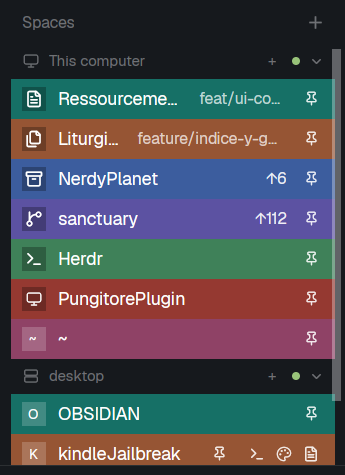

# Spaces

The top half of the left sidebar: a scrollable list of the places you work, one row per space. Every row is a solid block of the space's own colour, deepened so the white name on it reads, with a small square chip at the left carrying the space's icon or its first letter. A space that is not a git checkout shows nothing after its name; a space inside a repository shows the repository and the branch after it, and how many commits it is ahead or behind — but only where that is unusual, so the usual "on main" is left out. The rows are grouped under a header per computer, so a space that lives on another machine sits under that machine's name with its own icon and a dot saying whether the machine is up. Clicking a row switches to that space, right-clicking opens its menu, dragging a row onto another reorders it.



**What you see:**

The whole block is the `spaces` node of the sidebar in `layouts/herdr.json`: 268px wide, `background: "chrome"`, sitting under the 46px brand bar, above the 42px dock, and sharing the sidebar's remaining height equally with the agents list below it (`weight: 1` each, `min: 90`). The mod paints its own background with `theme().chrome`, so it matches the column around it. Body text is 13px.

Top to bottom:

- **Header bar, 31px.** "Spaces" in 11.5px `theme().dim` at 16px from the left, 10px from the right. At the right end a 26x26 button, corners rounded 6, holding `mods/workspace-chrome/plus.svg` at 14px; under the pointer it takes `theme().hover` behind and `theme().foreground` for the glyph.
- **The list.** 8px of padding left and right, 14px below the last row, and the scrollbar always shown (`overflow_y_scrollbar().mode("always")`).
- **A header per machine, 26px.** Left to right: a 13px glyph (`mods/workspace-chrome/monitor.svg` for this computer, `server.svg` for another), the machine's name in 11px `theme().dim` — "This computer" for the local one — then, for a machine that is not connected, its state in words ("asleep", "unreachable"), then a 6px round dot (`theme().ansi2` when connected, `theme().dim` when not), then an 11px chevron (`chevron-down.svg` open, `chevron-right.svg` folded). The name is truncated; a name longer than 140px is cut at "rebuilt ·".
- **A space row, 30px** (28px for a row nested under its repository), square corners, 8px of padding, filled with the space's own colour. Left to right: an 18x18 square chip, then the name, then the git tail, then the pin, then the hover buttons.
  - **The chip**: if the space has an icon, the chip is black at 27% (`#00000045`) with the icon at 13px in white; if not, the chip is white at 19% (`#ffffff30`) with the space's first letter, uppercased, at 10.5px bold in white.
  - **The name**: 13px white (`#ffffff`), truncated, and never squeezed below 48px.
  - **The git tail**: 11.5px, right-aligned, "repository · branch" in white at 72% (`#ffffffb8`), truncated; then `↑N` for commits ahead and `↓N` for commits behind, both in white at 90% (`#ffffffe6`). The repository is left out when the space is named after it, and the branch when it is named after it too or when it is `master` or `main`. A detached HEAD shows "(detached)".
  - **The pin**: an 11px `mods/workspace-chrome/pin.svg` in white at 88% (`#ffffffe0`), in a slot 18px wide, on a pinned space.
  - **The hover buttons**: three 19px squares, 1px apart, drawn in white at 88% — `workspace-chrome/terminal.svg` (start Claude), `herdr-dock/palette.svg` (icon and colour), `workspace-chrome/file-text.svg` (notes). Under the pointer one of them takes white at 20% (`#ffffff33`).
- **A row nested under its repository**: indented 22px, starting with a 13px `workspace-chrome/branch.svg` in white at 88% instead of the letter chip. It shows no repository name — it is under it.
- **The end of an empty group**: a 28px row, corners rounded 7, reading "New space there" with a 12px `workspace-chrome/plus.svg`, in 12px `theme().dim`; under the pointer it takes `theme().hover` and `theme().foreground`.
- **A group still loading**: a 28px row reading "Loading…" in 12px `theme().dim`.
- **A machine that needs a login**: under its header, a two-line block — "needs a login: run" in 11px `theme().blocked`, then `hc machine login <name>` in 11px `theme().muted`, then a "Copy" button (12px tall, `theme().raised` behind, `theme().hover` under the pointer) that reads "Copied" after it is pressed.
- **A machine that was rebuilt or replaced**: its header shows "rebuilt ·" (or the error) and a "Connect" link in `theme().muted` (`theme().foreground` under the pointer).
- **A machine whose agents stop at logout**: a `theme().blocked` "⚠" after the name.

The colours are the space's own, and there are six of them: `ansi6` `#22a99a`, `ansi3` `#e3814f`, `ansi4` `#5b8def`, `ansi5` `#8b7cf6`, `ansi2` `#3fae6a`, `ansi1` `#d9649a`. A space that has no colour of its own gets the least-used of the six. Each is darkened by 34% for the row, and the row you are in is that shade lightened 10% toward white, the row under the pointer 20% toward white. In full, `ansi6`: row `#167066`, active `#2d7e75`, under the pointer `#458d85`.

**How it behaves:**

- **Agent status is not shown in this list.** A row carries no status mark: state lives in the agents list next to it. The one place a status appears is the narrow rail (a sidebar under 160px), where a space shows "●" when it is `blocked` or `done` and "·" when it is `working` or `idle`, in `theme().blocked`, `theme().done`, `theme().working`, `theme().idle` (no status: `theme().unknown`). This layout declares a 268px sidebar, so the rail only appears once that edge is dragged in.
- **Click** a row to switch to that space (`space.select`); the terminals follow it.
- **Right-click** a row to open its menu: the `herdr-menu` popup, 230x320, with Rename, then New worktree and Open worktree (once the menu has checked the space's folder and found a repository) and Remove worktree (only for a worktree), Pin space (or Unpin space), Icon and colour…, Notes…, Claude (no permissions), and Close.
- **Drag** a row onto another to reorder it: a 2px `theme().accent` line appears along the top or bottom edge of the row you are over, showing where it will land, and the row you dragged dims to half opacity until you let go. Release it on the row you pressed and it selects instead. Release it on a row belonging to another machine and nothing happens.
- **Hover** a row to bring out the three buttons: start Claude in that space, open its icon-and-colour dialog, open its notes. They sit in the row rather than over it, so the name and the git tail give up the width instead.
- **Pin** a space with the pin glyph on its row. A pinned space keeps its glyph, and the space menu refuses to close it ("Close (pinned — unpin first)"). While every space is pinned (the dock's "Pin every space", or the menu's), a space made afterwards is pinned as it appears.
- **Fold a machine** by clicking its header; the group collapses to the header and the fold is remembered between restarts.
- **Connect** a rebuilt machine from its header: Herdr forgets the old machine and pairs again with the same name and target.
- **The "⚠"** opens the machine card, where the fix for agents stopping at logout is offered.
- **The plus in the header bar** makes a new space on this computer; the "New space there" row makes one on that machine.
- **The list re-orders itself.** A space that is a git worktree is moved under the space of the main checkout of the same repository; Herdr is told with `space.move`. The re-order runs at most once a second, and only once every machine involved reports its layout as ready.
- **Git details** (branch, repository, ahead, behind) are read when a place first appears, when a space moves to another folder, when a machine comes back, and every 60 seconds while the window is in front. A repository on this computer is also watched as a folder, so a commit or a checkout there shows up at once.
- **New spaces** appear at once, except a worktree space: it waits up to 1.5 seconds for its git, so it lands under its repository instead of jumping.
- **The row you are in** is scrolled into view whenever it changes, or when its place in the list changes.

**Built from:**

- **The layout.** `layouts/herdr.json`, the user's own layout:

  ```
  root (row, background canvas, divider 1px border, titlebar none)
  ├── sidebar (column, 268px, min 44, max 480, background chrome, resizable false)
  │   ├── brand (block, mod workspace-chrome, 46px, window_drag)
  │   ├── sidebar-lists (column)
  │   │   ├── spaces (block, mod herdr-spaces, weight 1, min 90)   ← this mod
  │   │   └── agents (block, mod herdr-agents, weight 1, min 90)
  │   ├── dock (block, mod herdr-dock, 42px)
  │   └── sidebar-footer (block, mod workspace-chrome, props footer, 69px)
  ├── work (column, resizable false)
  │   ├── tabs (block, mod herdr-tabs, 42px, window_drag)
  │   ├── work-body (row, padding 8, gap 8)
  │   │   ├── main (block, tab active, pane header herdr-pane 30px top, focus #3fae6a)
  │   │   └── panel (column, 368px, min 280, max 900, hidden)
  │   └── status (block, mod workspace-status, 28px)
  ├── b037df0d… (block, mod pungitore-panel, 320px)
  └── b9551b73… (block, mod zz-dump, 200px)
  ```

  The mod's block carries no props: `{ "mod": "herdr-spaces" }`. `mod.json` is `{ "place": "none", "title": "Spaces", "cloned_from": { "name": "spaces", "version": "0.1.16" } }` — `"place": "none"` means it appears only where a layout puts it.
- **The mod itself.** `mods/herdr-spaces/main.js`, a clone of Herdr's shipped `spaces` mod (version 0.1.16) with these changes: rows are filled with the space's colour deepened 34% instead of the theme's selected colour, the name is white instead of `theme().foreground`, the letter chip is white at 19% and the icon chip black at 27%, the git tail is white-tinted instead of `theme().dim`, the space's icon is drawn (the shipped mod has only the letter), a pin glyph and three hover buttons were added, the row corners are square instead of rounded 8, and the right-click menu is `herdr-menu` (230x320) instead of the shipped `menu` (200x260). `main.js` also exports `glyph(status)` and `tone(theme, status)`, which nothing else in this setup imports.
- **`herdr` functions it calls.** `spaces()`, `machines()`, `panes()`, `run(name, args)`, `openOverlay(spec)`, `exec(cmd, args, {cwd, on})`, `hc(args)`, `theme()`, `shared(key)`, `setShared(key, value)`, `watchFolder(path)`, `window()`, `layout()`.
- **Commands it runs.** `space.select {id}`, `space.move {id, index}` (index is 1-based), `space.new {}` and `space.new {machine}`, `tab.new {name: "Claude", space, argv: ["claude", "--dangerously-skip-permissions"]}`, `app.settings {section: "machines"}`.
- **Overlays it opens.** `herdr-menu` as a popup 230x320 with `props {tab: "space", target: {id}}`; `herdr-look` as a dialog 430x600 with `props {space}`; `herdr-notes` as a dialog 480x580 with `props {space}`; the shipped `machine-add` as a dialog 560 wide.
- **Programs it runs.** `git rev-parse --path-format=absolute --show-toplevel`, `git rev-parse --path-format=absolute --git-common-dir`, `git symbolic-ref -q HEAD`, `git rev-list --left-right --count HEAD...@{upstream}`, each with `{cwd, on}` so a space on another machine is asked there; `hc machine ls --json` every 15 seconds; `hc machine rm <name>` and `hc machine add <target> [--via <target>] [--name <name>] [--session <session>] [--temp]` when connecting a rebuilt machine.
- **Its art.** `mods/workspace-chrome/`: `plus.svg`, `branch.svg`, `terminal.svg`, `file-text.svg`, `pin.svg`, `monitor.svg`, `server.svg`, `chevron-down.svg`, `chevron-right.svg`. `mods/herdr-dock/palette.svg`. A space's icon may also be an emoji, or one of the glyph names `herdr-look` offers (stored as `svg:<name>` and resolved to `mods/workspace-chrome/<name>.svg`).
- **Shared state.** `space.colors` (space id → colour name or `#rrggbb`), `herdr.spaceIcons` (space id → icon), `herdr.pinned` (ids of pinned spaces), `herdr.pinNew` (true while every space is pinned). The first two are the same keys `herdr-agents`, `herdr-look`, `herdr-pane` and `herdr-tabs` read, so all of them agree on a space's colour and icon; the last two are the same keys `herdr-dock` and `herdr-menu` read.
- **Its own storage.** `localStorage["machines.folded"]` (folded machines) and `localStorage["machines.reconnecting"]` (machines being re-paired).

**Watch out:**

- **A bug in the code, inherited from the shipped mod.** In `due()` the pane's new busy state is written before it is compared with the old one:
  ```js
  busy[p.pane] = p.status === "working" || !(p.program?.shell || p.program?.agent);
  if (this.busy[p.pane] && !busy[p.pane]) this.sameRepo(...)
  ```
  `this.busy[p.pane]` has just been overwritten, so the condition can never be true and the "a command or an agent's turn just ended" refresh never fires. Ahead and behind therefore only move when a place is new, a space moves, a machine comes back, the 60-second fallback runs, or a local repository's folder changes. Fix it by keeping the old value before the assignment.
- **The fallback only runs while the window is in front** (`window().active`). With the window in the background, a remote space's branch and counts stay as they were until it comes forward.
- **Remote repositories are never watched as folders.** `watchFolder` works on this computer only, so a commit on another machine shows up on the 60-second tick at the earliest.
- **`herdr-app check` warns.** `init()` calls `refreshMachines`, which runs `hc machine ls --json` for real during the check; the mod never calls `checking()`. The check still passes (exit 0), but it prints "mod called hc; it runs for real".
- **The mod writes while it renders.** `render()` assigns colours and calls `setShared("space.colors", ...)`, and `ordered()` issues `space.move` commands to nest worktree spaces under their repository. `setShared` re-renders every mod, so this can start a second pass.
- **The tree markers are never drawn.** `ordered()` computes "├─" and "└─" for nested rows, but only the branch glyph is rendered, so a last child looks like any other child.
- **The rail needs a sidebar under 160px.** The narrow rail (numbers, pin marker, status dot) appears only when the live layout tree's sidebar `size.px` is under 160; this layout declares 268px. The sidebar column's own `"resizable": false` only stops resizing *within* it — the boundary that sizes it belongs to the root row, which is resizable, so dragging that edge (or `layout.resize {id: "sidebar", px: 240}`) narrows it and the rail replaces the rows.
- **The rail numbers are model positions, not screen positions.** The number shown is the space's index in `spaces()` plus one, so after the worktree nesting the numbers no longer follow the order on screen.
- **The hover buttons squeeze the row.** They are laid out in the row, not over it: the name and the git tail are truncated to make room.
- **Colours are pruned.** A colour whose space is gone is dropped from `space.colors`, and a space named "~" is never given one of its own (it falls back to `ansi6`).
- **The pin flag stays on.** `herdr.pinNew` is set by "Pin every space" and cleared by "Unpin every space" only; unpinning one space by hand leaves new spaces being pinned.
- **Concurrency is capped at six** places at a time (twelve git processes). A few hundred spaces would otherwise run past the app's 256 open files (when started from the Dock on macOS) or a core's 16 running execs; those spaces wait for the 60-second fallback.
- **The list is polled every 250ms**, and `panes()` copies every pane on each poll.
- **The mod assumes other mods are installed**: `herdr-menu`, `herdr-look`, `herdr-notes`, the shipped `machine-add`, and the `workspace-chrome` and `herdr-dock` SVGs. Without them, the right-click menu, the icon dialog, the notes and the hover buttons fail.
- **The Claude button runs Claude with `--dangerously-skip-permissions`.** That is the point of the button, but it is worth knowing before clicking it.
- **A space's repository is taken from its first terminal's live folder**, not from the folder it was made in, so a space that `cd`s elsewhere changes its row.

**Done when:**

- `herdr-app check ~/.config/herdr-app/mods/herdr-spaces` exits 0 (it warns that `hc` ran for real).
- With one space open, the sidebar shows one 30px row: an 18px chip with the space's first letter in white on white-at-19%, the space's name in white, and the row filled with the space's colour deepened 34% (`#167066` for `ansi6`).
- Clicking that row switches to the space and the terminal block follows it.
- With a space inside a git repository on a branch that is neither `main` nor `master`, the row shows "repository · branch" in white at 72%, and `↑N` / `↓N` appear once the repository is ahead or behind.
- A space whose repository has no upstream shows no counts.
- A worktree space appears indented 22px under the space of the main checkout, starting with the branch glyph and without the repository name.
- Right-clicking a row opens the `herdr-menu` popup with Rename, Pin space, Icon and colour…, Notes…, Claude (no permissions) and Close in it.
- Hovering a row reveals the three buttons; the palette button opens the `herdr-look` dialog, and setting an icon there puts that icon on the row's chip (and on the space in the agents list, which read the same shared key).
- Clicking the pin glyph on a row adds the pin glyph; the space's menu then offers "Close (pinned — unpin first)" instead of "Close".
- Dragging a row over another shows a 2px accent line along the edge it will land on, and releasing there reorders the list.
- With a second machine added, a `server.svg` header appears above that machine's spaces with its name, a 6px dot and a chevron; clicking the header folds the group, and the fold is still there after a restart.
- A machine that needs a login shows "needs a login: run" and `hc machine login <name>` with a Copy button under its header.
- (Needs the sidebar dragged under 160px — its edge belongs to the root row, which is resizable.) Narrowing the sidebar replaces the rows with a rail of 32px cells: the space's number, its icon, a pin marker and a status dot — "●" in `theme().blocked` or `theme().done` for a blocked or finished space, "·" in `theme().working` or `theme().idle` for a working or idle one.
