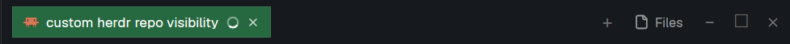

# Tabs

A 42px bar across the top of the work column, to the right of the sidebar: one tab for each tab of the space in front. The active tab is filled with the space's own colour darkened 40%, so its white letters read on it; the other tabs lie flat on the bar's own background. Each tab carries the program's icon, a name (or, for an agent, the title the agent is showing right now), and a mark when an agent inside it is working, blocked or has finished; the active tab also has a small × to close it. To the right of the tabs: a "+" that opens the new-tab menu, a "Files" button that opens the side panel, and — on Linux and Windows, where Herdr draws no window buttons of its own — minimize, maximize and close. The wheel over the bar steps through the tabs, a tab can be dragged onto another to move it, and the empty parts of the bar drag the window.



**What you see:**

The bar is the `tabs` node of `layouts/herdr.json`: a `block` in the `work` column, 42px tall, with `window_drag: true`, between the 268px sidebar on the left and the `pungitore-panel` block on the right, sitting above the `work-body` row of panes. It spans the whole width of the work column — the panes below it are inset by the row's own 8px of padding and 8px of gap, the bar is not.

Left to right:

- **The bar.** One row, everything centred vertically in the 42px, 3px between its parts. `theme().chrome` behind it, a 1px rule in `theme().border` along the bottom edge. 10px of padding at each end; on macOS the left padding is widened to clear the traffic lights (in this layout it stays 10px — see **Watch out**).
- **The tab strip**, the left part of the bar, taking all the width the buttons do not. It scrolls sideways (`overflow_x_scrollbar()`) and paints a scrollbar when the tabs do not fit. The tabs sit in a row with 3px between them.
- **A tab, 29px tall**, 10px of padding at each end, 7px between its parts, square corners, a 1px border (`theme().border` when it is the active tab, `theme().chrome` when it is not, so an inactive tab looks borderless but still takes the border's width). Text 12.8px, in `theme().muted` when the tab is not active.
  - **The icon**: 14px, the program's own icon from the app's program table. A one-colour icon is drawn with `svg()` and tinted — `theme().muted`, or white at 75% (`#ffffffc0`) on the coloured active tab; any other icon is drawn with `image()` in its own colours. A tab whose program has no icon shows none.
  - **The name**: the tab's label, cut off with an ellipsis at 170px. A tab somebody named keeps that name; a tab nobody named shows its program ("Claude Code", "zsh"), or "Terminal" when the tab holds no terminal at all. A tab running an agent follows the agent's live title instead, unless that title is the terminal address, the program name, a path, or holds an "@". A tab marked zoomed gets a " Z" after the name.
  - **The status mark**, 6px square, square corners:
    - **working**: a 12px arc (`mods/workspace-chrome/spinner.svg`) turning once every 900ms, in `theme().working` — white on the coloured active tab.
    - **blocked**: the 6px square in `theme().blocked` — white on the coloured active tab.
    - **done**: the 6px square in `theme().done` — white on the coloured active tab.
    - **idle**: nothing at all.
  - **The ×**, on the active tab only: a 12px cross (`mods/herdr-pane/close.svg`) in `theme().dim`, or white at 72% (`#ffffffb8`) on the coloured tab.
- **The "+" button**: a 26x26 square with its corners rounded 6, a "+" in the UI font size (13px) in `theme().dim`; under the pointer it takes `theme().hover` behind and `theme().foreground` for the glyph.
- **The panel buttons**: "Files" and, when it is enabled, "Changes". 26px tall, 8px of padding at each end, 5px between a 14px glyph and the 12px label, corners rounded 6. The glyph is `mods/files/file.svg` or `mods/changes/changes.svg`, tinted with the text. The one whose panel is open has `theme().selected` behind it and `theme().foreground` for the label; the other has `theme().chrome` and `theme().muted`. Under the pointer either takes `theme().hover`.
- **The window buttons**, only where Herdr draws none of its own (Linux and Windows, with `"titlebar": "none"`): three 26x26 squares with their corners rounded 6, glyphs in `theme().dim`, `theme().hover` behind under the pointer. On Windows the glyphs are the mod's own SVGs at 16px — `win-min.svg`, `win-max.svg` or `win-restore.svg`, `win-close.svg`; elsewhere they are the characters "−" and "□" and the cross from `mods/herdr-pane/close.svg` at 13px.

The active tab's fill is the space's own colour, darkened 40%. The six space colours are `ansi6` `#22a99a`, `ansi3` `#e3814f`, `ansi4` `#5b8def`, `ansi5` `#8b7cf6`, `ansi2` `#3fae6a`, `ansi1` `#d9649a`; darkened 40% they are `#14655c`, `#884d2f`, `#37558f`, `#534a94`, `#266840`, `#823c5c`. A colour picked by hand (`#rrggbb`) is darkened the same way (`#e2564a` → `#88342c`). A space with no colour of its own wears the `ansi6` teal `#14655c`. That is the same shade the pane header wears, so the bar and the pane below it are the same colour; the sidebar row is a little lighter (darkened 34%, `#167066` for `ansi6`).

**How it behaves:**

- **Every status has its own look**, as above. The mark is the *tab's* status — the most urgent status among the agents in that tab (blocked beats done beats working beats idle) — so a tab with one blocked agent and another working agent shows the blocked square. `done` means the agent finished while you were looking away; the moment you look at it, it becomes `idle` and the square goes away. A tab with no agent at all shows nothing.
- **Only the spinner moves.** It is a native animation (`svg(...).spin(900)`), not a redraw loop. The mark still takes room: a 6px square and the 7px gap before it, so a tab grows by 13px when its status appears and shrinks again when it goes, which can push the tabs along the strip.
- **Click** a tab to show it (`tab.select`); the terminals follow it. Clicking the tab you are already on does nothing.
- **Double-click** a tab to rename it (`tab.rename`), which opens Herdr's prompt for the name.
- **Drag** a tab onto another to move it (`tab.move`). The drag is press on one tab, release on another; the moved tab keeps its own contents.
- **Right-click** a tab to open its menu: the shipped `menu` mod as a popup 200 wide, with `props {tab: "tab", target: {id, space}}` — Rename, New tab, Close.
- **The ×** on the active tab closes it (`tab.close`). Closing the last tab of a space closes the space, and Herdr asks first.
- **The "+"** opens the shipped `new-menu` as a popup 250x512: a "Terminal" row (a new tab running the machine's shell), then "Start an agent" with the agents known on that machine, each with its number to type, then "New space", "New worktree…" and "Open worktree…".
- **The panel buttons** open and close the side panel — the `panel` column of the layout, 368px wide, to the right of the panes. Clicking the button whose panel is open closes it; clicking the other one switches the panel to it and opens it.
- **The window buttons** minimize, maximize (or put the window back) and close the window.
- **Hover** a tab and it takes `theme().hover` behind; hover a button and it takes `theme().hover` behind and `theme().foreground` for its glyph.
- **The wheel over the bar** steps through the tabs (`tab.next` / `tab.prev`). A mouse wheel, which reports lines, moves one tab per notch. A touchpad, which reports pixels, moves one tab per 20px of travel and then one per 60px, at most one every 100ms; a pause of 250ms or a change of direction starts the count again.
- **The strip scrolls.** When the tabs do not fit, the strip scrolls sideways and the active tab is scrolled into view — when the selection changes, when the strip itself changes size, and when a tab at or before the active one changes width (a rename, a status mark appearing).
- **The colour follows the space.** The active tab's fill is the front space's colour, so switching to a space of another colour repaints the tab at once.
- **The panel is remembered per space.** Which panel is open is stored against the space it was opened in: open the panel in one space, switch to another and the panel closes, switch back and it opens again, on the panel it was on.
- **The mod binds no keys of its own.** The app's keys do the same things: `ctrl-1`…`ctrl-9` show a tab by its position, `ctrl-tab` / `ctrl-pagedown` / `alt-]` the next tab, `ctrl-shift-tab` / `ctrl-pageup` / `alt-[` the previous one, `ctrl-shift-t` a new tab, `ctrl-shift-w` closes the tab in front, `f2` renames it.
- **The window is dragged by the parts of the bar that are not a control.** The tabs and the buttons stop the press, so a drag that starts on one of them never moves the window; a drag that starts on the bar's padding, or on the gap between its buttons, does.

**Built from:**

- **The layout.** `layouts/herdr.json`, the person's own layout (a clone of Herdr's shipped `main`):

  ```
  root (row, background canvas, terminal_padding 14 12, divider 1px border, titlebar none, traffic_lights 12 16)
  ├── sidebar (column, 268px, min 44, max 480, background chrome, resizable false)
  │   ├── brand (block, mod workspace-chrome, 46px, window_drag)
  │   ├── sidebar-lists (column)
  │   │   ├── spaces (block, mod herdr-spaces, weight 1, min 90)
  │   │   └── agents (block, mod herdr-agents, weight 1, min 90)
  │   ├── dock (block, mod herdr-dock, 42px)
  │   └── sidebar-footer (block, mod workspace-chrome, props footer, 69px)
  ├── work (column, resizable false)
  │   ├── tabs (block, mod herdr-tabs, 42px, window_drag)          ← this mod
  │   ├── work-body (row, padding 8, gap 8)
  │   │   ├── main (block, tab active, pane header herdr-pane 30px top, focus #3fae6a)
  │   │   └── panel (column, 368px, min 280, max 900, hidden)
  │   │       └── panel-body (stack, active files)
  │   │           ├── files (block, mod files)
  │   │           └── changes (block, mod changes)
  │   └── status (block, mod workspace-status, 28px)
  └── b037df0d… (block, mod pungitore-panel, 320px)
  ```

  The block carries no props: `{ "mod": "herdr-tabs" }`. The mod is told nothing by the app; everything it shows it reads from `spaces()`, `panes()`, `layout()` and shared state.
- **The mod itself.** `mods/herdr-tabs/main.js`, a clone of Herdr's shipped `tabs` mod (version 0.1.16) with these changes:
  - the active tab is filled with the space's colour darkened 40% (`#14655c` for `ansi6`) with white letters, instead of `theme().raised` with `theme().foreground`; the icon, the status mark and the × on it are white on that fill (`#ffffffc0`, `#ffffff`, `#ffffffb8`);
  - the tab's corners are square — the shipped mod rounds them 7 — and the 6px status mark is a square, where the shipped mod rounds it 3;
  - the assets are read from `mods/herdr-tabs/` and `mods/herdr-pane/` instead of `mods/tabs/` and `mods/pane/`;
  - everything else — the strip, the wheel, the drag to reorder, the panel buttons, the window buttons — is the shipped mod's, unchanged.
- **`mod.json`.** `{ "place": "none", "title": "Tabs", "cloned_from": { "name": "tabs", "version": "0.1.16" } }` — `"place": "none"` means it appears only where a layout puts it.
- **`herdr` functions it calls.** `spaces()`, `panes()`, `run(name, args)`, `openOverlay(spec)`, `theme()`, `window()`, `shared(key)`, `layout()`, `settings()`. It also uses the built-in `localStorage`.
- **Commands it runs.** `tab.select {id}`, `tab.rename {id}`, `tab.move {id, index}` (index is 1-based), `tab.close {id}`, `tab.next`, `tab.prev`, `layout.select {stack, child}`, `layout.show {id}`, `layout.hide {id}`, `window.minimize`, `window.maximize`, `window.close`.
- **Overlays it opens.** The shipped `menu` as a popup 200 wide with `props {tab: "tab", target: {id, space}}`; the shipped `new-menu` as a popup 250x512.
- **Programs it runs.** None. It starts no timer, spawns no task, and reads no file.
- **Its art.** `mods/herdr-tabs/win-close.svg`, `win-max.svg`, `win-min.svg`, `win-restore.svg` — 16px viewboxes, `stroke="currentColor"`, stroke-width 1, drawn at 16px; the cross, the maximize square, the minimize line and the restore two-boxes are all one pixel wide. Borrowed: `mods/workspace-chrome/spinner.svg` (a 24px arc) for the working mark, `mods/herdr-pane/close.svg` for the tab's × and for the window close button, `mods/files/file.svg` and `mods/changes/changes.svg` for the panel buttons, and the program's own icon from the app's program table (`icons/<program>.svg`).
- **Shared state it reads.** `space.colors` (space id → a colour name like `ansi6` or a picked `#rrggbb`), the same key `herdr-spaces`, `herdr-agents`, `herdr-pane` and `herdr-look` read, so the tab, the sidebar row, the agents list and the pane header agree on a space's colour; and `workspace.panels` (the list of panel buttons to show — `["files"]` at the moment, so only "Files" appears; the shipped default is `["files", "changes"]`).
- **Its own storage.** `localStorage["panels"]`, a JSON object of space id → the panel that space had open (`"files"`, `"changes"`, or nothing for closed).

**Watch out:**

- **The shipped mod is replaced on every start; this clone is not.** Herdr rewrites its own `mods/` on start, so the shipped `tabs` comes back fresh with every update; `herdr-tabs` is the person's and survives. But nothing carries the clone forward: a new Herdr version that changes the shipped `tabs` leaves this copy behind, and a build that starts from the shipped source again gets the old look — rounded tab corners, a rounded status mark, `theme().raised` for the active tab and the assets under `mods/tabs/` and `mods/pane/`.
- **A tab moved to the right lands one slot past the target.** The drop index is the target's position in the *old* order (`space.tabs.findIndex(...) + 1`), so dragging a tab leftwards puts it exactly where the target was, while dragging it rightwards leaves it after the target rather than on it — and dragging the last tab onto an earlier one can leave it at the end. The shipped mod behaves the same way.
- **The panel buttons need two ids in the layout.** The mod looks for a node called `panel` and a stack called `panel-body` in the layout tree and drives them with `layout.show`, `layout.hide` and `layout.select`. This layout has both. In a layout without them the buttons are drawn but do nothing, and the commands fail.
- **The "Changes" button is not there.** `workspace.panels` is `["files"]`, and nothing in the setup writes it, so the changes panel cannot be opened from the bar at all. Adding `"changes"` to that list brings the button back (and the panel comes with it, `changes` being the second child of the `panel-body` stack).
- **The mod runs commands and writes storage while it renders.** `render()` calls `syncPanel()`, which may issue `layout.show` / `layout.hide` / `layout.select` and writes `localStorage["panels"]`. The `pending` guard (one second) keeps it from looping, but a build that renders purely would lose the per-space panel memory.
- **The panel is left alone on the very first space.** The mod skips the restore for the first space it ever sees, if that space has no stored choice: the panel is not closed for it, even though every later space with no stored choice is. From that moment on the space is recorded like any other, so the panel it happens to be showing is the one it will be remembered with.
- **A settled tab still appears.** `tab.settle` puts a tab away on this screen, but this mod lists every tab of the space, settled ones included; nothing folds them.
- **The tab's label is the tab's, not the space's.** Two tabs of the same space with the same program read the same until an agent gives one a title of its own.
- **The window art is Windows-only.** `win-min.svg`, `win-max.svg`, `win-restore.svg` and `win-close.svg` are only drawn when `window().platform === "windows"`; on Linux the buttons are the characters "−" and "□" and the cross from `mods/herdr-pane/close.svg`, and on macOS there are no window buttons at all (Herdr draws the traffic lights).
- **Three of the assets belong to other mods.** `mods/workspace-chrome/spinner.svg`, `mods/herdr-pane/close.svg`, `mods/files/file.svg` and `mods/changes/changes.svg` are read from their own folders. If `herdr-pane` or the shipped `workspace-chrome`, `files` or `changes` is renamed or removed, those glyphs draw nothing.
- **The macOS left padding is 10px in this layout, but only by luck.** The mod reserves `(traffic_lights[0] + 64) / zoom - sidebar width` for the traffic lights, so with the 268px sidebar and `traffic_lights: [12, 16]` the sum is 76 - 268 and the floor of 10px applies. Hide the sidebar (`ctrl-shift-b`) and the padding becomes 76px at zoom 1, so the bar clears the lights; a zoom other than 1 scales it.
- **The wheel gesture is not one notch per event on a touchpad.** A pixel-scrolling device needs 20px for the first tab and 60px for each one after, at most one every 100ms; a device that reports lines at all takes the line path, and a reported line count of zero does nothing.
- **The names are cut off at 170px.** A long agent title is truncated with an ellipsis and there is no tooltip; the pane header shows the same title in full.
- **The colour is darkened only if it is a 6-digit hex.** `deepen()` leaves anything else as it is, so a colour name that is neither one of the six nor a theme colour falls back to `theme().dim` and is used as it is.
- **The layout's blocks all point at mods that exist.** `layouts/herdr.json` ends with the
  `pungitore-panel` block, and `herdr-app status` reports no errors.
- **The repo copy and the installed copy drift apart.** The mod runs from `~/.config/herdr-app/mods/herdr-tabs`; the copy in `Projects/Herdr/mods/herdr-tabs` is the source it was written from. They are identical now.

**Done when:**

- `herdr-app check ~/.config/herdr-app/mods/herdr-tabs` exits 0.
- With one space open, the bar shows one tab per tab of that space, 29px tall in a 42px bar, with the active tab filled `#14655c` for a space coloured `ansi6` and its letters in white.
- The tab of the space in front shows the program's icon at 14px and the program's name (or the agent's live title); a tab somebody named keeps its name, and a tab marked zoomed carries a " Z".
- Clicking another tab shows it, and the terminals below the bar follow it.
- Double-clicking a tab opens Herdr's rename prompt; the new name sticks in the bar.
- Pressing one tab and releasing on another moves that tab to the other's place.
- Right-clicking a tab opens the `menu` popup with Rename, New tab and Close in it.
- The active tab shows a ×; clicking it closes the tab, and closing the last tab of a space asks before closing the space.
- An agent that is working shows a 12px arc turning once every 900ms; a blocked one and one that finished while you were away show a 6px square; an idle one shows nothing.
- The wheel over the bar shows the next or previous tab, one notch at a time.
- Clicking "Files" opens the 368px panel to the right of the panes with the files mod in it; clicking "Files" again closes it; switching to another space closes it, and switching back opens it again on the panel it was on.
- With more tabs than fit in the bar, the strip scrolls sideways and the tab in front is scrolled into view.
- Switching to a space of another colour repaints the active tab in that colour.
- On Linux, the three window buttons sit at the right end of the bar and minimize, maximize and close the window.
