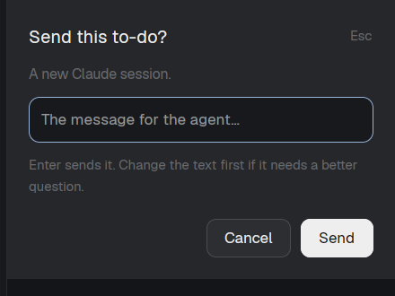

# Send to-do

The dialog that stands between a to-do in the Pungitore panel and a session.
Clicking a to-do opens this: the to-do is already written in the box, so it can
be read, changed, and only then sent out as the first message of a new Claude
session. Enter sends it, Esc cancels it.

**What you see:**

A dialog 520px wide and 260px tall, on `theme().popover`, with 18px of padding
and 10px between the rows:

- **The title row.** "Send this to-do?" in 15px semibold `theme().foreground`, and
  at the right end "Esc" in 11px `theme().dim`.
- **The line under it.** "A new Claude session in `<repository>`." in 11.5px
  `theme().dim` — the name of the repository the to-do came from. Without a name
  (the dialog opened on its own) it reads "A new Claude session.".
- **The message box.** 38px tall, 10px of padding, corners rounded 9, a 1px
  `theme().input` border that turns `theme().accent` while the box has the
  keyboard, on `theme().background`, with the text in 12.8px
  `theme().foreground`. The to-do is in it when the dialog opens; with no
  to-do the box shows the placeholder "The message for the agent…".
- **The hint.** "Enter sends it. Change the text first if it needs a better
  question." in 11px `theme().dim`.
- **The extra line**, only when the to-do came with one: a sentence in 11px
  `theme().muted`, under the hint. A quick to-do carries "The session refines
  this to-do and writes it into this repository's TODO.md." — so the agent is
  not left to guess what the to-do is for. A to-do from the repository's
  `TODO.md` carries none, and the line is not there.
- **The buttons**, at the right: "Cancel" — 32px tall, 14px of padding, corners
  rounded 8, a 1px `theme().input` border on `theme().raised`, in
  `theme().foreground` — and "Send", the same shape in `theme().solid` with
  `theme().solid_foreground` on it. Both fade to 88% under the pointer.

**How it behaves:**

- **The to-do arrives as a prop.** The dialog is opened with
  `props { space, folder, name, text, hint }`: the space's id, the folder its
  terminals start in, the repository's name to show, the to-do text, and the
  hint about what the session will do with it. The text is put in the box
  whole, so the person edits the message rather than writing one from nothing.
  The hint is optional: with none, no extra line is drawn.
- **The keyboard is on the box from the start.** The input takes the focus when
  the dialog opens, and again after 600ms, in case the first attempt came too
  early. The border tells which of the two it is: `theme().accent` while it has
  the keyboard.
- **Enter sends.** The text in the box, trimmed, becomes the first message of a
  new session: `tab.new` in that space, in that folder, running `claude`, with
  the text as the agent's task. A notification then names the repository and
  repeats the message. The dialog closes either way.
- **Esc and Cancel send nothing.** Esc is handled by the dialog itself; the
  button closes the overlay. Nothing is started, and the to-do is still open in
  the panel.
- **An empty message is not sent.** A box with nothing in it closes the dialog
  without starting anything.

**Built from:**

- **The mod itself.** `mods/pungitore-confirm/main.js`, default-exporting a
  class extending `View`, with `mod.json` as `{"place": "none", "title": "Send
  to-do"}` — `"place": "none"` means it appears only where something opens it.
- **The `herdr` functions it calls:** `props()` for what it was opened with,
  `run("tab.new", …)` to start the session, `notify()` to report it,
  `closeOverlay(props().overlay)` to close, and `theme()` for the colours.
- **The `gpui-base` controls it uses:** `InputState` (the text the box holds)
  and `Input` (the box drawn around it).
- **Who opens it:** the Pungitore panel, with `openOverlay({ mod:
  "pungitore-confirm", kind: "dialog", width: 520, height: 260, props: {…} })`.

**Watch out:**

- **The message is a single line.** The box is Herdr's `Input`, one line of
  text; a long message is cut off at the end of the line and scrolls sideways.
- **The box sends with Enter.** There is no way to type a line break into the
  message: Enter sends it.
- **Sending is not undoable.** The session is a tab like any other; the to-do
  is not ticked off in `TODO.md` and the message that went out is not kept
  anywhere but the session's own history.
- **The dialog is a mod of its own**, so it has to be installed next to the
  panel. Without it, the panel's to-do rows open nothing.
- **`herdr-app check` mounts the dialog.** The check loads the mod for real,
  and it appears over the window with no props — an empty box and "A new Claude
  session." Close it with `herdr-app do overlay.close '{}'`.

**Done when:**

- Clicking a to-do in the Pungitore panel opens this dialog with the to-do
  written in the box, the repository's name in the line above it, and the
  keyboard in the box.
- Changing the text and pressing Enter (or clicking Send) opens a new tab in
  that space, running `claude` in that repository's folder, with the edited
  text as its first message, and a notification names the repository and
  repeats the message.
- Pressing Esc (or clicking Cancel) closes the dialog and starts nothing.
- Sending an empty message closes the dialog and starts nothing.
- A to-do opened from the quick list shows one extra line under the hint:
  "The session refines this to-do and writes it into this repository's
  TODO.md." A to-do opened from the repository's own list shows no such line.
