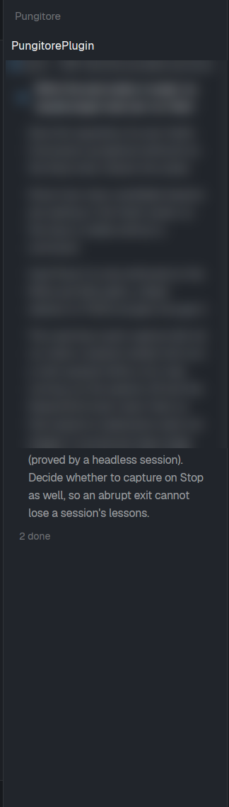

# Pungitore panel

A permanent column on the right of the window that shows every repository you
are working in the way the workflow sees it: the open to-dos from its
`TODO.md`, the branch it is on, and what the agents in it are doing. The first
open to-do is marked as the next action, and clicking a to-do starts a session
with that to-do as the agent's first message.

**What you see:**

- A full-height column, 320px wide in this layout, on a `theme().surface`
  background, padded 8px, with the rows 2px apart. It scrolls with a scrollbar.
- One word at the top, "Pungitore", in 11px `theme().dim`, padded 4px left and
  4px bottom. Everything under it is per repository.
- One block per repository, 6px above and below, its rows 3px apart. A block
  appears only for a space that has at least one open to-do.
- The block's first row is the repository's name — the last path segment of the
  space's folder — in 12px semibold `theme().foreground`, truncated. To its
  right, the branch in 10.5px `theme().dim`, when Herdr knows one.
- Then one line per agent working in that space: a 7px round dot in the
  agent's status colour, and the status word followed by the agent's title
  (`working — Writing the eval suites`), in 11px `theme().muted`, truncated.
  The dot is green `#3fae6a` for working, amber for blocked, blue for done and
  grey for idle; an unknown status falls back to `theme().dim`, and an agent
  reported as `error` is drawn in the blocked colour.
- Then the open to-dos, at most six. Each is a row with 8px of side padding
  and 3px above and below, rounded 5px, that turns `theme().hover` under the
  pointer. Its marker is `▶` in 11px `theme().accent` for the first one and
  `·` in 11px `theme().dim` for the rest; its text is 11.5px,
  `theme().foreground` for the first one and `theme().muted` for the rest.
- Under the to-dos, `+N more` in 10.5px `theme().dim` when the repository has
  more than six open ones, and `N done` in the same style when its `TODO.md`
  has ticked boxes.

**How it behaves:**

- The repository's `TODO.md` is canonical. This panel only mirrors it, and it
  reads the file itself — `cat <folder>/TODO.md`, with the space's machine as
  the `on` host, so a repository on another machine is read over there — rather
  than asking Herdr for a cached copy, so the mirror cannot drift from the
  truth. An open to-do is a line matching `-` or `*`, then `[ ]`, then the
  text; a ticked line (`[x]` or `[X]`) counts towards the "done" total.
- Every five seconds the panel re-reads every space that has a folder and
  redraws. A change to a `TODO.md` shows up within five seconds, with no
  reload and no keypress.
- Clicking an open to-do starts a session on it: `tab.new` in that space, in
  that repository's folder, running `claude`, with the to-do text as the
  agent's first message. It asks nothing first — the click is the go. A
  notification then names the space and repeats the to-do.
- The `▶` marks the first open to-do as the next action. It is a marker, not a
  filter: clicking any to-do starts that one.
- The panel reads what Herdr knows about the space: its folder, its branch and
  its agents. It never asks git anything itself.

**Built from:**

- The layout's node tree. `layouts/herdr.json` is a root row with four
  children: the 268px `sidebar` column, the `work` column, then two blocks —
  `pungitore-panel` at 320px and a 200px block this repository does not carry.
  This mod is that 320px block, and it is the last one that draws; nothing else
  in the tree depends on it.
- The mod itself: `mods/pungitore-panel/main.js`, default-exporting a class
  extending `View`, with `mod.json` as `{"place": "right", "size": 320}`.
- The `herdr` functions it calls: `spaces()` for the spaces and their folders,
  `agents()` for the agents in them, `exec("cat", …)` to read each `TODO.md`,
  `run("tab.new", …)` to start a session on a to-do, `notify()` to report it,
  `theme()` for the colours, and `checking()` to stand down during
  `herdr-app check`.
- Its art: none. Every mark is drawn — the `▶` and `·` markers are text, the
  status dot is a 7px rounded box, the repository name is text.

**Watch out:**

- **A repository with no open to-do never appears.** The panel keeps only the
  spaces whose to-do list is non-empty, so the "no TODO.md" and "nothing to do"
  messages in the code cannot be reached — a repository whose `TODO.md` is
  missing, or whose boxes are all ticked, is simply not there. The "N done"
  counter only ever appears next to a repository that still has something open.
- **The to-do text is the `TODO.md` line with the box stripped.** The regex
  allows leading whitespace, so an indented sub-item counts as a top-level
  open to-do and takes a slot of its own. A line written as `[ ]` with no
  `-` or `*` in front is not seen at all.
- **Six to-dos is all you get.** The rest are counted in "+N more" and cannot
  be opened from here — go to the repository's `TODO.md`.
- **Clicking a to-do starts `claude`**, not whatever agent the space uses, and
  it starts it in the space's folder with the to-do as the first message. There
  is no confirmation and no undo short of closing the tab.
- **The folder is the space's folder, not where its terminals are.** A space
  whose terminals have moved still shows and still opens the repository it was
  made in. The branch is Herdr's, not git's: no branch, nothing shown.
- **One `cat` per space every five seconds.** A space on a machine that cannot
  be reached waits for the exec timeout on each poll, and the panel shows
  nothing for it until the machine answers.
- **The panel is read-mostly.** It cannot edit `TODO.md`, reorder to-dos or
  mark one done — the repository's file is the only place that changes.

**Done when:**

- A space whose repository has an open to-do shows the repository's folder
  name, its branch when Herdr knows one, and the to-do as the first `▶` line.
- Clicking that line opens a new tab in that space running `claude` in that
  folder, with the to-do text as its first message, and a notification names
  the space and repeats the to-do.
- A repository with seven or more open to-dos shows six of them and "+1 more".
- A repository whose `TODO.md` has ticked boxes as well as open ones shows
  "N done" under its open to-dos; a repository with nothing open is absent
  from the panel.
- An agent working in that space shows its status word and title under the
  repository name, with the dot in that status's colour.
- Editing the repository's `TODO.md` while the panel is open changes what the
  panel shows within five seconds, with no reload.
